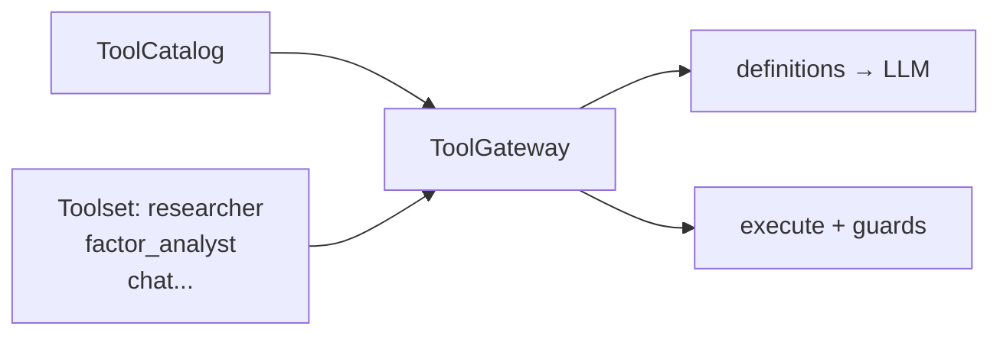

# A2 — ToolGateway + 分角色 Toolset 设计

> 2026-09-29 · Agent Runtime 工具面  
> 状态: Design → Implementation

---

## 1. 问题

| 现状 | 后果 |
|---|---|
| `build_default_registry()` 18+ 工具全注册 | 上下文噪音、选错工具 |
| 角色白名单散落在 `role_factory._ROLE_TOOL_WHITELIST` | 难复用、chat 与 study 不一致 |
| `allowed_tools` / `readonly` / `restrict` 三套过滤入口 | 语义重叠 |
| 无工具 manifest | 无法按域/只读标签组 toolset |

**A2 目标**：工具集成为数据；**一个 Gateway** 管过滤、schema、执行。

---

## 2. 概念

```text
ToolCatalog   全部工具 + 标签 (domain, readonly)
Toolset       命名白名单（角色 / 任务）
ToolGateway   catalog × toolset → 暴露 definitions + execute
```



---

## 3. Toolset 命名（首批）

| name | 用途 | 特征 |
|---|---|---|
| `minimal` | 只读探查 | read / list / help |
| `chat` | 通用对话 | 读写文件 + 因子 + 行情 |
| `researcher` | 研究轮 | 行情/因子/检索 |
| `factor_analyst` | 因子分析 | compute + factor_* |
| `strategist` | 策略回测 | write + run_backtest |
| `backtest_diagnostics` | 诊断 | backtest + chart |
| `critic` / `evaluator` | 评审 | history + analysis |
| `full` | 全量（默认回退） | 不过滤 |

角色白名单从 `role_factory` **迁入** `toolsets.py`，role_factory 只引用。

---

## 4. 接口

```python
# core/agent/toolsets.py
TOOLSETS: dict[str, list[str]]
def resolve_toolset(name_or_tools: str | list[str] | None) -> list[str] | None
def apply_toolset(registry: ToolRegistry, toolset: str | list[str] | None) -> ToolRegistry

# core/agent/gateway.py
class ToolGateway:
    def __init__(self, registry, *, toolset=None, allow=None, deny=None)
    def definitions(self) -> list[dict]
    def execute(self, name, params) -> str
    @property
    def names(self) -> list[str]
```

规则：
- `toolset=None` 或 `"full"` → 不过滤
- 未知 toolset 名 → 最小集（fail-safe）
- `allow`/`deny` 在 toolset 之上再过滤（deny 优先）

---

## 5. 接线

| 调用点 | 改动 |
|---|---|
| `role_factory` | 白名单改为 `resolve_toolset(role)` |
| `chat_loop` | `toolset="chat"` 可选；默认保持 `allowed_tools` 兼容 |
| `AgentLoop` | 构造可传 `gateway=ToolGateway(...)`；仍兼容 `allowed_tools` |

**兼容**：`allowed_tools=[...]` 仍可用，内部走 Gateway。

---

## 6. 测试

1. toolset 解析（命名 / 列表 / None / 未知名）
2. apply 后 schema 只含白名单
3. deny 优先于 allow
4. execute 未授权 → error JSON
5. role_factory 白名单与 toolsets 一致

---

## 7. 非目标

- 动态工具发现 / MCP 自动注册
- 工具结果 views（A3）
- 运行时热插拔 toolset
