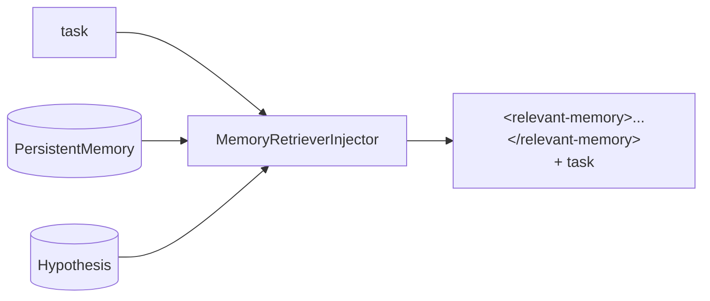

# A4 — Memory Retriever → pre_run 注入设计

> 2026-09-29 · Agent Runtime 记忆面  
> 状态: **Implemented**

---

## 1. 问题

| 记忆层 | 现状 |
|---|---|
| 工作上下文 | loop 在用 |
| 情景记忆 `PersistentMemory` | **几乎不进 prompt** |
| 语义记忆 Hypothesis/Goal | Goal 有 injector，Hypothesis/失败史弱 |

结果：研究轮之间不连续，重复踩坑。

---

## 2. 方案

新增 **`MemoryRetrieverInjector`**（`order=-90`，紧跟 Goal 注入）：

```text
task → PersistentMemory.find_relevant(task, k)
     → 可选 Hypothesis 摘要
     → 前置 <relevant-memory> 块
```



---

## 3. 规则

| 项 | 默认 | 说明 |
|---|---|---|
| `k` | 5 | top-k 条目 |
| `max_chars` | 2000 | 注入总预算，超出截断 |
| `min_score` | 0 | 过滤弱匹配 |
| 失败 | 静默 | 召回异常不影响 run |
| 空结果 | 不注入 | 无块 = 无噪音 |

块格式：

```xml
<relevant-memory>
- [type/name] body (first 200 chars)
...
</relevant-memory>
```

---

## 4. 接口

```python
class MemoryRetrieverInjector:
    def __init__(self, memory=None, *, max_results=5, max_chars=2000, include_hypotheses=False)
    order = -90
    def inject_pre_run(loop, task, messages) -> str
```

`build_default_injectors()` 追加该 injector；`AgentLoop.enable_memory_injection` 默认 True（可用构造参数关闭）。

---

## 5. 测试

1. 空记忆 → task 不变
2. 有相关条目 → 含 `<relevant-memory>`
3. max_chars 截断
4. 召回抛错 → task 不变
5. include_hypotheses 开关
6. 默认 injectors 含 memory_retriever

---

## 6. 非目标

- 向量库 / embedding 服务化
- 自动写回记忆（学习环）
- 跨 workspace 记忆隔离策略
