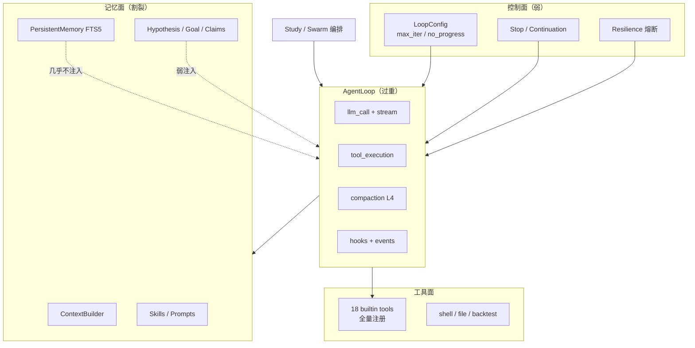
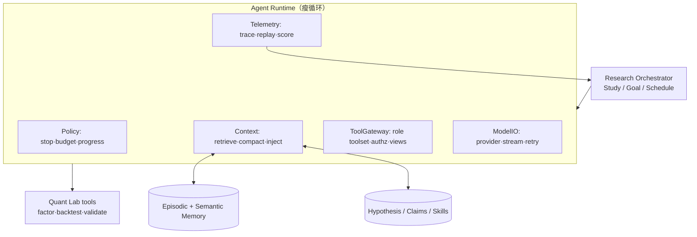

# Agent 架构重估（AI Agent 工程视角）

> 2026-09-29 · 评审对象：`agent/` + `study/` + `swarm/` + `llm/` + 工具面  
> 角色：AI Agent 架构师 · 不评代码整洁，评 **agent 系统设计是否正确**

---

## 0. 结论先行

| 维度 | 评分 | 一句话 |
|---|---|---|
| 单步 ReAct 循环 | B+ | Step 化拆得对，但循环本体仍是上帝对象 |
| 工具系统 | C+ | 数量够、契约弱，缺「按任务选工具」 |
| 上下文/记忆 | C | 压缩靠摘要，检索记忆几乎没接进 loop |
| 长程研究编排 | A- | 假设/可证伪 claim/AEGIS 是真差异化 |
| 多 Agent | C+ | Swarm=整装 Agent DAG，贵且糙 |
| 可观测/评测 | D+ | 有事件流，无 agent 回放与回归评测 |
| 安全 | B- | shell 有门控，工具沙箱未真正落地 |

**总判**：量化域 + 研究闭环（Hypothesis/Claims）是产品级资产；**Agent 运行时是「能跑的工程」不是「可进化的 agent 平台」**。瓶颈不在功能多少，而在 **控制面与记忆面未产品化**。

---

## 1. 现架构（实际生效路径）



问题图景：**上下文只在「当前消息窗口」里演进**，长期记忆与研究状态是旁路数据库。

---

## 2. 优点（应当保留）

1. **Loop Strategy 化**：`Step` Protocol（pre_run / llm_call / compaction / stop / progress / resilience / tool_execution / finalization）方向正确，便于换策略与测试。
2. **失败语义诚实**：`no_progress`（tool_call hash 窗口）、`max_iter`、熔断、wrap-up nudge（0.8×max_iter）——比很多 demo agent 严谨。
3. **Provider Adapter**：thinking 抽取、DSML 清洗、配额错误映射、`resolve_max_tokens` 自动预算——生产级细节。
4. **研究闭环独特性**：`Hypothesis` 血统 + `claims` 可证伪预测 + `AEGIS` 门禁 + `loop_evolution` GA 调参——这是 **研究型 agent** 的正确形态，不是聊天机器人。
5. **事件溯源**：EventStore → SSE → projector，适合回放（但还没做成调试产品）。

---

## 3. 核心缺口（按 Agent 工程优先级）

### P0 控制面：没有「任务预算」一等公民

| 现状 | 后果 | 应有 |
|---|---|---|
| 只有 `max_iterations` | 一次工具风暴可烧完 token/钱 | **Token/Cost/Time 三维预算**，StopStep 统一裁决 |
| 工具结果硬截断 2000 字符 | 大表/回测结果被掐，agent 读残 | **工具契约：schema + 分页/摘要视图 + 预算元数据** |
| token 估算 `chars/3` | 中文/JSON 严重低估 | 真实 tokenizer 或按消息类型标定 |

### P0 工具面：全量工具 ≈ 全量噪音

- 18 工具每次注入 → 上下文浪费、选错工具、错误率上升。
- 应有：**工具目录（manifest）→ 按角色/阶段加载**；Study 阶段 toolset ≠ chat toolset。
- 工具结果统一 envelope：`{status, data, views:{table|json|text}, next_hint}`，而不是裸 JSON 字符串。

### P1 记忆面：三套记忆互不说话

```text
工作上下文  ContextBuilder / compaction     ← loop 真用
情景记忆    Session 事件 / Memory FTS5      ← 少召回
语义记忆    Hypothesis / Skills / Goal      ← 弱注入
```

缺：**Retriever 在每轮 pre_run 的确定性注入**（相关假设、历史失败因子、技能片段），而不是靠 system prompt 写死。

### P1 运行时：AgentLoop 上帝对象

`loop.py` 同时管：流式解析、工具执行、压缩持久化、hook、事件、stop 决策。  
**应拆**：

```text
AgentRuntime
├── Policy      (stop / budget / progress)     # 纯函数
├── Context     (load / compact / retrieve)
├── ToolGateway (authz / schema / result view)
├── ModelIO     (stream / retry / provider)
└── Telemetry   (events / trace / replay)
```

### P1 多 Agent：Swarm = N 个完整 AgentLoop

成本高、上下文重复、协作协议弱（只是 DAG 依赖）。  
研究场景更该是：

- **1 个 Orchestrator + 轻量子任务**（tool 式调用，共享工作区与记忆）
- 角色差分用 **prompt + toolset + policy**，不是 35 份 preset 复制整装 agent

### P2 评测：没有 agent 回归网

- 无 golden tasks（因子挖掘 / 回测诊断 / 归因）
- 无 trace 重放评分（工具选择正确率、关键路径命中）
- `claims` 校准很好，但 **agent 自身质量** 无度量 → 每次改 loop 靠人肉测

### P2 安全

- shell 有 `SR_ALLOW_SHELL_TOOLS` ✅  
- 文件/网络/子进程边界未统一 ToolGateway 授权 ❌  
- sandbox `legacy` 与 StaticSandbox 分裂，能力实际未封

---

## 4. 目标架构（建议）



**四条铁律**

1. **预算即控制**：token/费用/时间与 iteration 同级，Policy 一处裁决。  
2. **工具即产品**：manifest + 视图 + 授权，禁止「18 个默认全开」。  
3. **记忆即特征**：每轮 pre_run 可测试地注入相关假设/失败史。  
4. **评测即护栏**：golden task + trace score，改 runtime 必须过网。

---

## 5. 落地顺序（与此前「入口合并」互补）

| 阶段 | Agent 工程项 | 预期 |
|---|---|---|
| A1 | 三维预算进 StopPolicy | 防烧钱，行为可预期 |
| A2 | ToolGateway + 分角色 toolset | 上下文↓，工具准确率↑ |
| A3 | 工具结果 schema/views | 大结果可读、可截断策略化 |
| A4 | Memory retriever 进 pre_run | 研究连续性 |
| A5 | Loop 拆 Policy/Context/GW/ModelIO | 可测、可替换 |
| A6 | Orchestrator + 轻量子任务，收敛 Swarm | 成本↓ |
| A7 | Golden tasks + replay score | 改动可回归 |

与 W1–W4（CLI/双轨清理）可并行：那条线减复杂度，这条线 **加 agent 竞争力**。

---

## 6. 一句话

> 这是一台 **「带研究方法论的 Agent 机器」**，方法论（假设/证伪/AEGIS）领先；  
> 但 **运行时仍是单体 ReAct**。下一阶段应投「预算控制 + 工具网关 + 记忆检索 + 评测网」，而不是继续加角色 preset。
