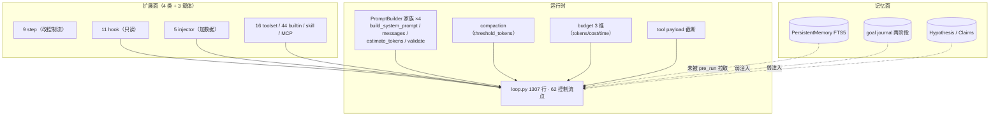
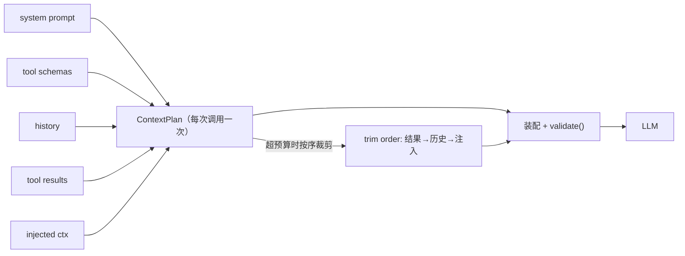

# Agent 设计框架重估（第三遍） — 2026-10

> 视角：顶级架构师 + Agent 设计工程师。评「agent 系统设计是否正确」，不评代码整洁。
> 与前两遍分工：遍一 = 依赖方向与分层（`architecture-reeval-20261008.md`）；遍二 = SSE 双轨与热点校正（`architecture-reeval2-20261008.md`）；**本遍 = agent 运行时与扩展框架本身**。
> 基线：`agent-architecture-review.md`（2026-09-29，A1–A7）。

## 0. 结论

**方法论层已领先，运行时层已工程化，但「上下文」仍是无主的资源。**

- 9-29 评审的 A1/A2/A5/A7 **已落地**：三维预算模块、16 个命名 toolset、9 个 strategy step、70 题 golden eval + nightly 门禁。
- A4（记忆检索进 loop）**只做了一半**：`MemoryRetrieverInjector` 存在，但 `strategy/steps/pre_run.py` **零调用**——记忆仍是旁路库。
- **本遍新发现（最重要）**：**上下文没有仲裁者**。每个层各自截断（tool payload 截断、compaction 阈值、injector 无脑追加），**没有一处计算「这一次 LLM 调用装得下什么」**；`PromptBuilder.validate()` 契约已定义却**零调用**（死契约）。

## 1. 自查：9-29 的 A1–A7 今天什么状态

| 项 | 状态 | 证据 |
|---|---|---|
| A1 三维预算 | ✅ 已落地 | `core/agent/strategy/budget.py`（tokens/cost/time 一处裁决） |
| A2 toolset 分角色 | ✅ 已落地 | `core/agent/toolsets.py` 16 套 + `resolve_toolset/apply_toolset`，未知名降级 minimal（fail-safe） |
| A3 工具结果 envelope | ◐ 半落地 | `ToolResult` / `to_payload` 存在；**`views` 只在文档出现 1 次**，未成为契约 |
| A4 记忆检索进 loop | ❌ 未接线 | `MemoryRetrieverInjector` 有实现，**`pre_run.py` 零调用**（T11 仍 open） |
| A5 Loop 拆 Policy/Context/GW/ModelIO | ◐ 半落地 | 9 个 step + 4 个 PromptBuilder 家族；`loop.py` 仍 1307 行 / 62 处控制流 |
| A6 Swarm 收敛 | ❌ 未做 | `swarm/runtime.py` 756 行，`AgentExecutor` ×3、`ThreadPool` ×2、layer 提及 88 |
| A7 评测网 | ✅ 已落地 | `evals/` 70 题 + `nightly-baseline.json` + nightly 门禁 |

## 2. 现行 Agent 运行时（实际形态）



**读法**：扩展面已经分好工（`extension-points.md` 的决策树成立）；运行时是「一个胖 loop + 一圈已接好的插头」；**记忆面整体悬空**。

## 3. 本遍的核心问题：上下文没有仲裁者

### 3.1 证据

| 事实 | 位置 |
|---|---|
| 工具结果本地截断 | `tools.py::_truncate_payload` |
| 压缩按阈值触发 | `loop_compaction.py`（`threshold_tokens` ×4） |
| token 估算散落 | `loop.py` `estimate_tokens` ×4 |
| **PromptBuilder.validate() 契约** | `prompt_builder.py` 定义 4 个 builder 各实现 |
| **validate 从未被调用** | `loop.py` / `loop_compaction.py` 中 `.validate(` = **0** |
| injector 追加不计账 | `context_injector.py` 4 个实现无预算参数 |

### 3.2 为什么这是 P0

Agent 的第一资源是**一次调用的上下文窗口**，不是工具数也不是角色数。
当前每个供给侧都在**局部**做决定：

```
system prompt  ─┐
tool schemas   ─┤
history        ─┼─→ 各层各自截断/追加 ─→ 无人算总量 ─→ LLM
tool results   ─┤
injected ctx   ─┘
```

后果：
1. **不可测**：无法回答「这轮为什么丢了那段 history」；
2. **不可预算**：`threshold_tokens` 只能事后压缩，不能事前规划；
3. **不可解释**：`validate` 是为「装配后校验」设计的，却从未运行——装配结果永远不体检。

## 4. 建议的目标形态：ContextPlan（上下文仲裁器）



**契约**（一个类、四个方法、零散点归零）：

```python
class ContextPlan:
    def allocate(self, parts: ContextParts, budget: int) -> ContextPlan: ...
    def trim(self) -> ContextParts: ...        # 有序裁剪
    def validate(self) -> ValidationResult: ... # 复用现成契约，改为强制调用
    def explain(self) -> dict: ...             # 为什么裁/留了什么
```

**裁剪顺序（建议）**：tool results → 历史中段 → 注入上下文 → 保留 system/tool schema。
**预算来源**：`budget.py` 已有 token 维；ContextPlan 消费它，避免第二套账。

**收益**：把 4 处局部决策收敛为 1 处策略；`validate` 从死契约变成活门禁；可写「上下文装配」单测。

## 5. 其余设计级问题（按优先级）

| # | 问题 | 证据 | 建议 |
|---|---|---|---|
| **G2** | **记忆检索未接线** | `pre_run.py` 对 MemoryRetriever 零调用 | 收尾 A4：pre_run 拉「相关假设 / 历史失败因子 / 技能片段」，**可测地注入**（这条直接提升研究连续性） |
| **G3** | **4 个编排系统边界未成文** | study(runner) / swarm / workflow / goal 各一套 | 写一张**编排选型树**（与 extension-points 并列）：单轮研究→study；多角色 DAG→swarm；确定性流水线→workflow；目标账本→goal。边界靠文档+类型隔离 |
| **G4** | **Swarm 仍是整装 AgentLoop × N** | `AgentExecutor` ×3、`ThreadPool` ×2 | 收敛为「1 orchestrator + 轻量子任务（tool 式，共享工作区/记忆）」；角色差分用 prompt+toolset 而非整装 agent |
| **G5** | **工具 envelope 未成契约** | `views` 仅文档提及 | 结果统一 `{status, data, views:{table/json/text}, next_hint, cost}`，截断策略随契约走 |
| **G6** | **PromptBuilder 4 实现重复** | Chat/StaticFile/_Null 各实现 4 方法 | 抽公共装配骨架，差异点留 hook；否则修一处漏三处 |
| **G7** | **loop.py 仍 1307 行** | 62 控制流点 | 随 G1（ContextPlan）把「装配」搬出 loop，loop 只剩调度 |

## 6. 与前两遍的合流建议（一页）

| 线 | 内容 | 顺序 |
|---|---|---|
| **结构线**（遍一/二） | 0a `scheduler._get_db` → 0b SSE 双轨收敛 → 1 study 路由切面 → 2 session service 拆 | 结构先行，为 agent 线腾出安全区 |
| **Agent 线**（本遍） | G1 ContextPlan → G2 记忆进 pre_run → G3 编排边界成文 → G4 Swarm 收敛 → G5 envelope | 竞争力线，可与结构线交错 |
| **共同护栏** | 契约测试 + eval 跟幅 + A/B 归因 | 不变 |

**不建议**：继续加角色 preset / 继续扩工具数 / 为 pyright 清零重写 mixin（这三条都在加复杂度而非加能力）。

## 7. 一句话

> 这套框架的**研究方法论是稀缺资产**（假设—证伪—AEGIS—两阶段 journal），扩展面也已分好工；
> 缺的不是机制，是**「一次 LLM 调用装什么」的统一裁决**。补上 ContextPlan，运行时才算闭环；
> 再把记忆检索接进 pre_run，研究连续性才真正成立。
