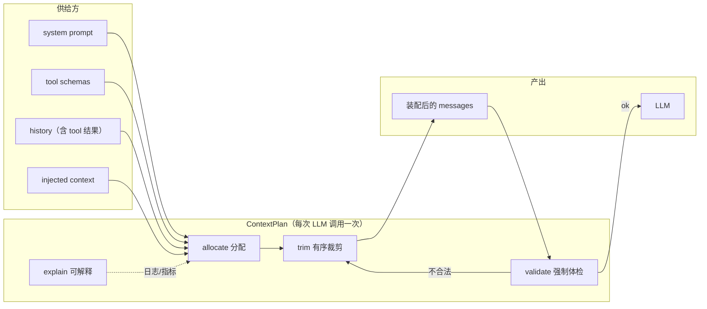
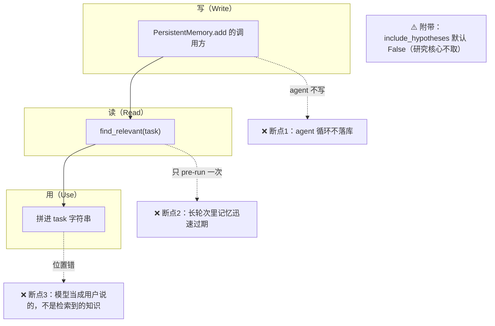
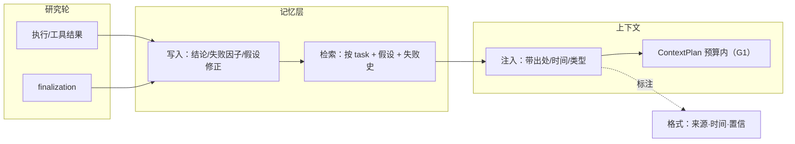

# G1 / G2 详细设计 — 上下文仲裁器 + 记忆闭环

> 来源：`agent-design-reeval-20261008.md` G1/G2 · 证据：代码实读（`prompt_builder.py` / `compact.py` / `loop_compaction.py` / `context_injector.py` / `loop.py` / `memory/persistent.py`）
> 性质：本文是 G1/G2 的**实施规格**（可派工），不是构想。

---

# G1 · ContextPlan（上下文仲裁器）

## G1.1 现状盘点（可核对的事实）

| 事实 | 位置 | 问题 |
|---|---|---|
| 3 套 token 估算并存 | `prompt_builder._estimate_chars//4`；`compact._estimate_tokens(chars_per_token=3.0)`；`utils/token_utils.estimate_tokens` | 同一上下文三个数，**预算无基准** |
| 工具结果本地截断 | `tools.py::_truncate_payload` | 不看全局预算，只看单条 |
| 压缩是**事后**触发 | `loop_compaction._maybe_compact_impl`：`tokens >= usable * overflow_ratio` 才压 | 装配时不知道会不会超，装配后才补救 |
| `PromptBuilder.validate()` **从未被调用** | 4 个 builder 都实现；`loop.py`/`loop_compaction.py` 中 `.validate(` = 0 | 装配结果**从不体检**，契约是死的 |
| 注入内容不计账 | `context_injector.py` 5 个注入器无预算参数 | 注入多少全凭注入器自己 `max_chars` |
| 预算常量多套 | `prompt_builder.DEFAULT_TOKEN_LIMIT=128_000`；`loop_compaction` 用 `model_context_tokens-4096`；`budget.py` 另有 token 维 | 三个「上下文上限」概念 |

**根子**：上下文有 5 个供给方（system / tools / history / tool results / injected），**没有一个地方对总量负责**。

## G1.2 目标形态



**不变式（测试即断言）**：
1. `plan.total_tokens <= budget` 恒成立（装配后必然满足）
2. `plan.validate().ok` 恒为 True（装配后体检通过）
3. 裁剪**只影响** history/injected，永不动 system 与 tool schemas
4. 同一输入 → 同一输出（确定性，便于回归对比）

## G1.3 契约（新增 `core/agent/context_plan.py`）

```python
@dataclass(frozen=True)
class ContextParts:
    system: str
    tools: list[dict]          # tool schemas
    history: list[dict]        # 含 tool 结果
    injected: list[dict]       # injector 产出

@dataclass
class ContextPlan:
    parts: ContextParts
    budget_tokens: int
    reserve_output_tokens: int
    used_tokens: int
    trimmed: list[TrimRecord]  # 裁剪审计：{part, 策略, before, after, 原因}

    # ① 分配：把总预算切给各部分，并给出不可裁部分
    def allocate(self) -> "ContextPlan": ...

    # ② 裁剪：按固定顺序削减，直到 total <= budget
    def trim(self) -> "ContextPlan": ...

    # ③ 体检：装配后强制校验（复活 PromptBuilder.validate）
    def validate(self) -> ValidationResult: ...

    # ④ 可解释：给 trace / debug 用
    def explain(self) -> dict: ...
```

**裁剪顺序（建议，固定且可测）**：

| 序 | 目标 | 策略 | 理由 |
|---|---|---|---|
| 1 | tool 结果（最老） | 先截断字符，再删整轮 | 结果可重算，优先级最低 |
| 2 | history 中段 | 复用 `compact.py` 的 `_select_by_token_budget` / `_score_turn` / `_ensure_tail_turns` | **不要重写评分**，compact 已有 |
| 3 | injected | 按注入器 `order` 倒序丢弃（后加的先丢） | 目标上下文优先级最高，todos/memory 次之 |
| 4 | system / tools | **永不裁** | 裁了就不是这个角色了 |

**预算公式**（单一来源，替代现有三套）：

```
budget = min(model_context_tokens, DEFAULT_TOKEN_LIMIT) - reserve_output_tokens - safety_margin
safety_margin = max(1024, budget * 0.05)
```

## G1.4 接入点

| 位置 | 改动 |
|---|---|
| `core/agent/strategy/steps/llm_call.py`（或 loop 调 `build_messages` 处） | 调用前 `plan = ContextPlan(parts, budget).allocate().trim()`；装配后 `plan.validate()` |
| `core/agent/prompt_builder.py` | `estimate_tokens` 统一委托 `utils/token_utils.estimate_tokens`（删 `//4`）；`DEFAULT_TOKEN_LIMIT` 改为从 config 派生 |
| `core/agent/loop_compaction.py` | 压缩**降级为兜底**：仅当 plan 裁不动仍超限才触发 L4 摘要 |
| `core/agent/budget.py`（`strategy/budget.py`） | token 维与 ContextPlan 共用同一 `estimate_tokens`；不做第二套账 |

## G1.5 迁移三步（每步可独立合入、独立验证）

| 步 | 做什么 | 验证 | 风险 |
|---|---|---|---|
| **G1-1 统一估算** | 三个估算器收敛为一个；`//4` 与 `3.0` 取一 | 单测：同一消息集三处估算值一致 | 低（只改数字） |
| **G1-2 影子模式** | ContextPlan 只算不裁，输出 `explain()` 到 trace | 观察 1 周：多少轮会超、超多少、谁被裁 | 零（不改行为） |
| **G1-3 开启裁剪** | 按顺序裁；压缩降为兜底 | eval 跟幅（mean/pass 不降）+ PR lane 绿 | **中**（上下文变化→行为变化） |

**回滚**：G1-3 一行开关（`context_plan.enabled`），可即时退回旧路径。

## G1.6 测试要求

| 类型 | 用例 |
|---|---|
| 单测 | 预算分配比例；裁剪顺序（tool 结果先于 history）；system/tools 不被裁；`validate()` 装配后必过；确定性（同输入同输出） |
| 回归 | 70 题 golden eval 跟幅；PR lane（`not llm and not e2e and not slow`）0 failed |
| 可观测 | trace 增 `context_plan.explain()`：budget/used/trimmed 列表 |

---

# G2 · 记忆闭环（G2 结论已更正）

## G2.1 先更正：记忆注入**已经接线**，不是「悬空」

上一版说「`pre_run.py` 零调用 → 记忆未接线」——**错了**，我查错了文件。实际：

- `MemoryRetrieverInjector` 已实现（`context_injector.py:265`，order=-90，`inject_pre_run`）
- `build_default_injectors()` 已把它放进默认链
- `AgentLoop.__init__`（`loop.py:437`）装配默认链
- `loop.py:571-574` **确实调用** pre-run 注入器（`order < 0`）
- 还有专门测试 `tests/test_memory_retriever_injector.py`

## G2.2 真实断点：三处，且都影响研究质量



### 断点 1：Agent 循环不写记忆

`PersistentMemory.add` 的调用方实测只有：

| 调用方 | 性质 |
|---|---|
| `cli/commands/slash_memory.py` | **人工**命令 |
| `core/mcp/server.py` | MCP 工具（人工/外部触发） |
| `core/memory/persistent.py` | 自身 |
| `core/agent/loop.py` / `tools.py` | **无写入**（`remember`/`save_memory`/`add_memory` 全 0 命中） |

**后果**：agent 在研究过程中发现的「这个因子在 2021 年失效」「这个 IC 阈值没意义」——**不沉淀**。下一轮研究、下一条假设重新从零开始。研究连续性断裂。

### 断点 2：只在 pre-run 注入一次

`loop.py:571` 的 pre-run 注入在**整个 run 开始时**执行一次。研究一轮可能几十次工具调用，记忆快照在第一秒就过期。

### 断点 3：注入位置是 task 字符串

```python
full_task = injector.inject_pre_run(self, full_task, [])   # loop.py:574
```

记忆块被**拼在 user task 前面**，进入模型时是「用户说的话」；而且 `messages` 传的是**空列表**，注入器看不到已有对话。
**后果**：模型无法区分「这是检索到的旧知识（可能过期）」与「这是本次任务要求」；无法对记忆内容做证伪/质疑——与本项目「claims 可证伪」的价值观直接冲突。

### 附带：假设默认不取

`include_hypotheses=False` 是默认（`context_injector.py:279`）。**hypothesis 是这个项目最核心的研究资产**（hypothesis/claims/AEGIS/journal），却默认不进上下文。

## G2.3 目标形态



## G2.4 具体改动清单

| # | 改动 | 文件 | 语义 |
|---|---|---|---|
| **M1** | **Agent 侧写回** | 新增 `core/agent/memory_writer.py`（或在 `finalization` step 落一条） | 从轮次产出提炼「结论 / 失败因子 / 假设修正」→ `PersistentMemory.add`；**不写原始日志，只写结论** |
| **M2** | **注入位置修正** | `context_injector.py` | 改为向 `messages` 注入独立消息（`role=system` 或 user 侧 `<retrieved-memory>` 块），**不再拼 task 字符串**；同时把现有 `messages` 传入（现在是 `[]`） |
| **M3** | **带出处与时间** | 同上 | 每条记忆标注 `[来源·日期·类型]`，让模型能判断新鲜度与权威性（服务 claims 可证伪） |
| **M4** | **刷新时机** | `context_injector.py` / loop | 保留 pre-run（order=-90）**并**增加按需刷新（order=0 档，N 轮或结论变化时重检索）；`loop.py:571` 已有 per-iteration 档（order==0）可挂载 |
| **M5** | **假设默认纳入** | `include_hypotheses` 默认改 True（按 role 可关） | 假设是研究核心资产 |
| **M6** | **纳入预算** | 依赖 G1 | 注入计入 `ContextPlan.injected`；超预算时按注入器 order 倒序丢弃 |

## G2.5 分期

| 期 | 内容 | 依赖 | 风险 |
|---|---|---|---|
| **G2-a** | M2 + M3（位置与出处）+ M5（假设默认） | 无 | **中**：prompt 形态变化→行为变化，须 eval 跟幅 |
| **G2-b** | M6（纳入 G1 预算） | G1-3 | 低 |
| **G2-c** | M1（agent 写回） | 无 | **中**：写回内容若噪声大会污染记忆库；先只写「失败因子 + 假设修正」两类 |
| **G2-d** | M4（按需刷新） | G2-a | 低 |

## G2.6 测试要求

| 类型 | 用例 |
|---|---|
| 单测 | 注入落在 messages 而非 task 串；每条带出处/时间；`include_hypotheses` 默认含假设；空记忆不注入且不报错 |
| 闭环测 | 跑一轮研究 → 断言记忆库新增「结论/失败因子」条 → 下一轮 pre-run 能检索到 |
| 回归 | 70 题 eval 跟幅（mean/pass 不降）；PR lane 0 failed |

---

# 合并建议与顺序

| 序 | 刀 | 依赖 | 产出 |
|---|---|---|---|
| 1 | **G1-1** 统一估算器 | — | 单一 token 基准 |
| 2 | **G2-a** 注入位置 + 出处 + 假设 | — | 研究上下文可证伪 |
| 3 | **G1-2** ContextPlan 影子模式 | G1-1 | 超预算实况数据 |
| 4 | **G2-c** agent 写回 | G2-a | 记忆闭环 |
| 5 | **G1-3** 开启裁剪 | G1-2 | 上下文不超限 |
| 6 | **G2-b/d** 纳入预算 + 按需刷新 | G1-3 | 全链路 |

**为什么 G2-a 排在 G1-3 之前**：它不依赖 G1，改动面小、收益直接（研究连续性 + 可证伪）；而 G1-3 会改变所有调用的上下文，风险更高，必须在上下文内容先稳定后做。

**为什么 G1-1 最先**：不统一估算，任何预算数字都无意义。
