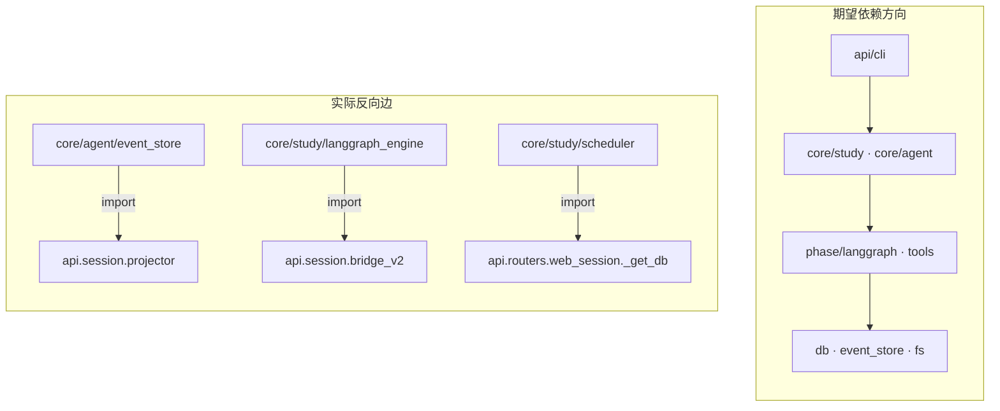

# 架构师重估 — 2026-10（对照 brief 的挑战意见）

> 角色：只评结构是否撑得住演进，不评功能对错。
> 对照：`architecture-refactor-brief-20261008.md`（下称 Brief）。
> 证据：文件体量 / 扇入 / 分层 import 方向 / 路由与服务表面。

## 0. 结论（先说判断）

**Brief 的六层图仍然「说」得通，但实现层已经发生依赖倒置；下一刀不应按 Brief 的 A（web_session↔projector），因为该文件对已不存在。**

真正的结构风险排序：

1. **core → api 反向依赖（3 处）** — 分层叙事失效
2. **`api/routers/study.py`（33 路由 / 1643 行）** — 控制面无边界
3. **`SessionService`（24 方法 / 1450 行）** — 队列+生命周期+Agent+压缩+摘要 合体
4. **`autoresearch.py`（1393 行 re-export 包）** — W-split 半拆遗留
5. **AgentLoop（40 方法 + 7 mixin 文件）** — kernel 仍过载（已注解止血 ≠ 解耦）

Brief 推荐的「A. web_session↔projector」应**作废**；`web_session.py` 已不存在，`projection_store.py` 仅 355 行且几乎无引用。

## 1. 依赖方向审计（最重要）

| 反向边 | 后果 | 修法 |
|---|---|---|
| `event_store` → `projector` | 事件内核绑死 HTTP 投影 | Projector 订阅 event，**不允许** event 反向认 projector |
| `langgraph_engine` → `bridge_v2` | 引擎知道 SSE | 引擎只 emit；SSE 由 api 层订阅 |
| `scheduler` → `web_session._get_db` | 编排打到路由私有函数 | 迁 `core/storage` 或注入 `SessionDB` |

**这是比分文件更优先的刀。** 反向依赖不除，后面任何「按层重构」都是文档工程。

## 2. 体量热点（校正 Brief）

| 文件 | 行 | 问题 |
|---|---|---|
| `core/goal/store.py` | 1773 | 单文件仓储（查询+写+迁移） |
| `api/routers/study.py` | 1643 / **33 路由** | 控制面、查询面、工件面、DAG、presets 混居 |
| `core/study/store.py` | 1619 | 同上 |
| `api/session/service.py` | 1450 / 24 方法 | 上帝服务 |
| `core/autoresearch.py` | 1393 | re-export 包 + 阶段函数 |
| `core/agent/loop.py` | 1307 / 40 方法 | kernel |

**Brief 的 web_session/projector 对已过时** — `web_session.py` 不在树上，`projection_store.py` 355 行、扇入≈0（死代码候选）。

## 3. 对 Brief 六层的诚实评价

| 断言 | 评价 |
|---|---|
| 「分层干净」 | **不成立**。纸面分层在，实现有 3 条 core→api 边 |
| 「债在层内巨文件」 | 部分成立；更致命的是**层间方向错误** |
| 「起手 A web_session↔projector」 | **作废**（对象已消失） |
| 「mixin 触达式」 | 同意；注解止血后仍勿专项 |
| 「不引入 EngineProtocol」 | 同意 |
| 「删除优于搬迁」 | 同意；`projection_store`、autoresearch re-export 面可直接清 |

## 4. 重估后的优先级

| 序 | 刀 | 目标 | 估工 | 为什么高于原 A |
|---|---|---|---|---|
| **0** | **断反向依赖 3 条** | core 不 import api | 1 天 | 分层成立的前提；每条都是运行时/测试耦合点 |
| **1** | **study 路由切面** | 33 路由 → 3 模块：lifecycle / query / artifacts（+ agents/presets） | 2 天 | 控制面无边界；改一处全表抖 |
| **2** | **SessionService 拆** | QueueService · AttemptRunner · HistoryCompactor | 2 天 | 与 1 同主题（session 控制面） |
| **3** | **autoresearch 消包** | 阶段函数归 `study/phases/*`，删 re-export | 1 天 | 1393 行名不副实 |
| **4** | store 读写分仓 | goal / study store 各拆 2 文件 | 2 天 | 体量大但边界清、风险低 |
| **5** | AgentLoop 去 kernel | 新能力进 Service，不进 loop_* mixin | 触达 | 已止血，不专项 |

## 5. 设计原则（建议写进 AGENTS/extension-points）

1. **依赖只准向下**：`core/**` 禁止 import `api/**` / `cli/**`（CI 可加 import-linter / 自定义检查）。
2. **引擎不感知传输**：emit / event_store 是唯一出口；SSE、projector、TUI 都是订阅方。
3. **路由无业务**：router = 参数校验 + 调 application service；≥15 路由必须分模块。
4. **Service 按生命周期切**，不按「方便」堆方法（SessionService 是反例）。
5. **W-split 完成的定义**：原文件只剩 re-export 时立刻删，不留 1300 行壳。

## 6. 与 Brief 的分歧清单（供拍板）

| # | Brief | 本重估 | 建议 |
|---|---|---|---|
| 1 | 起手 web_session↔projector | 对象已不在 | 改为**断反向依赖** |
| 2 | 六层干净 | 有 3 条反向边 | 先修方向再谈拆文件 |
| 3 | C 构造收口仍排 2 | 仍是小时级小刀 | 可穿插，不占主线 |
| 4 | 成功标准未定 | 建议用**依赖方向 0 反向 + 路由模块数** | 比「巨文件&lt;800」更硬 |

## 7. 下一步（若认同本重估）

1. 会签原则 §5（尤其依赖向下）。
2. 实施 0：三条反向边切断 + 回归（event/SSE/study 测试）。
3. 实施 1：study 路由按 lifecycle/query/artifacts 切面（T85 可改挂此处）。
4. import-linter 或 pytest 约定进 CI，防反向边复发。
