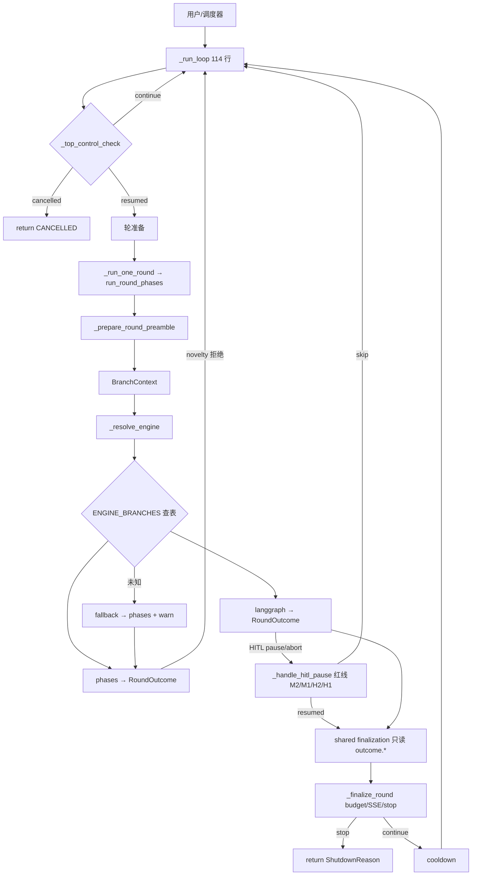
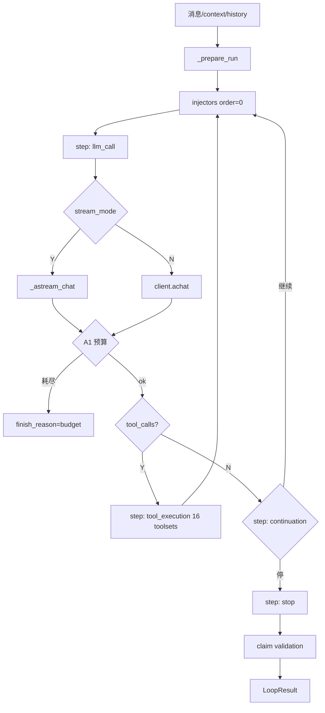
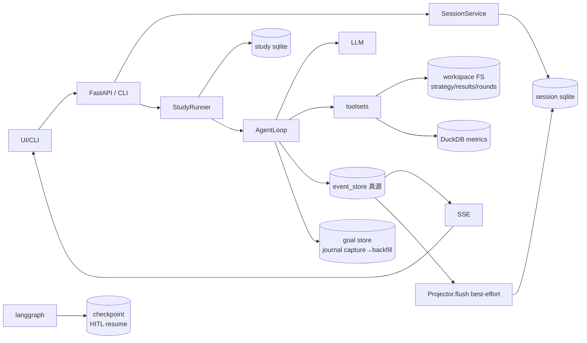

# 架构梳理与重构建议 — 2026-10（类型债收口后）

> 用途：继续重构前的架构讨论基线。图管结构，文管判断。
> 前置：`architecture-current-20261008.md`（契约）· `refactor-readiness-20261008.md`（切入点）· `extension-points.md`（7 入口分工）
> 本次增量：类型债 958→225 后的**结构债现状**与下一刀建议。

## 1. 六层架构（讨论用简图）

```
┌─────────────────────────────────────────────────────────────┐
│ 接入   CLI/TUI · FastAPI(20 routers) · WebUI · MCP            │
├─────────────────────────────────────────────────────────────┤
│ 编排   SessionService · StudyRunner · AgentLoop(6 mixins)     │
│        契约：BranchContext 入 → RoundOutcome 出               │
├─────────────────────────────────────────────────────────────┤
│ 引擎   phases / langgraph 查表 · goal · workflow · swarm       │
├─────────────────────────────────────────────────────────────┤
│ 能力   LLM adapters · 16 toolsets · memory · hooks · skills   │
│        扩展点：STEP 控制流 · hook 只读 · injector 只加数据     │
├─────────────────────────────────────────────────────────────┤
│ 数据   DuckDB · workspace FS · event_store · goal/checkpoint  │
├─────────────────────────────────────────────────────────────┤
│ 横切   evals 70 · observability · tests 12k · CI gates        │
└─────────────────────────────────────────────────────────────┘
```

**讨论要点**：分层仍然干净；债不在「层」，而在**层内巨文件**和**隐式耦合面**（mixin `self.*`、facade 与 `db.py` 双签名、`tool_errors` 吞返回类型）。

## 2. Study 执行流（重构后）



## 3. Agent ReAct 流



## 4. 数据流（红线版）



**红线**（重构勿破）：
1. event_store 是 session 消息真源，Projector 只是物化视图
2. goal journal 两阶段 capture→backfill（claims 可证伪依赖顺序）
3. workspace FS 是 study 的可 git 面
4. checkpoint 只属 langgraph；phases 无 resume

## 5. 类型债收口后的结构债现状

| 债 | 规模 | 性质 | 状态 |
|---|---|---|---|
| mixin 隐式 `self.*` | 9 mixin / ~69 字段 | 结构 | **已补 host 面注解**（止血）；composition 未做 |
| 巨文件 | web_session 1503 / projector 1493 / study store 1618 / goal store 1772 | 结构 | 待拆（切入点 A/E） |
| 双入口构造 | chat_loop / role_factory | 一致性 | 小时级可收口 |
| 扩展机制 7 入口 | steps/hooks/injectors/plugins/skills/mcp/toolsets | 设计 | 分工文档已立，机制合一未做 |
| facade vs `db.py` | DuckDBDataStore 10 方法 | 契约 | **已修适配**；与 Protocol 的 batch API 仍不对称 |
| `tool_errors` 返回类型 | BaseTool.execute 注解 vs 运行时 str | 认知债 | 已记 notes；注解仍是 `-> dict` |
| pandas stub 噪声 | 73 Attribute + 115 Argument | 机械 | 渐进 |

## 6. 专业建议（下一刀）

### 6.1 总原则（建议锁定）

1. **边界优先于纯洁性**：先切「同主题巨文件对」（web_session↔projector），不为 mixin 纯洁性开专项。
2. **契约驱动**：每刀定义输入/输出面（像 `BranchContext`/`RoundOutcome`），测试锁契约再搬代码。
3. **新代码禁增债**：mixin 不新增；`self._loop` 用 Protocol 不用 `object`；工具返回类型写运行时真型。
4. **删除优于搬迁**：双轨/假选项直接删（dag/env 先例），不写兼容 shim。

### 6.2 推荐排序（与 readiness §5 对齐 + 本次修正）

| 序 | 切入点 | 理由 | 估工 | 建议 |
|---|---|---|---|---|
| **1** | **A. web_session ↔ projector 拆分** | 同主题 1503+1493；event 三助手刚拆完顺势；边界清晰 | 2-3 天 | **起手**。拆成 models/handlers/store/facade（T85 已挂） |
| **2** | **C. chat_loop / role_factory 构造收口** | 两套构造=配置漂移；小时级 | 0.5 天 | 可与 A 并行穿插 |
| **3** | **B. mixin → composition（触达式）** | F821 根源已止血；不专项 | 每次触达 0.5 天 | 新方法进 Host/Service 对象；mixin 方法迁出后删 |
| **4** | **E. store 分仓** | study 1618 / goal 1772 同模式 | 2 天 | 查询面/写面拆文件，SQL 不动 |
| **5** | **D. 扩展机制收敛** | 7 入口分工已成文 | 需产品驱动 | 仅当出现「第 8 种机制」冲动时做 |
| **6** | **BaseTool.execute 注解对齐** | 认知债 | 0.5 天 | 注解改 `-> str` 或 doc 写明 wrapper |

### 6.3 明确不建议

- **不要**为了 pyright 清零做大范围 mixin 重写——收益是数字，不是运行时。
- **不要**引入第二套 DAG/引擎抽象（`phase-engine-refactor` 已勘误作废 EngineProtocol 草案）。
- **不要**把 goal/study store 迁 ORM/新 DB——查询面测试厚，SQL 分文件即可。
- **不要**合并 phases 与 langgraph——查表分派 + 双契约已够；统一执行引擎是另一产品议题。

### 6.4 每刀护栏（沿用）

1. 相关契约测试（RoundOutcome/BranchContext/dispatch/claims）
2. A/B 归因（stash 对照）
3. API 变更 → `openapi.json` + `types.gen.ts`
4. 语义红线：ARCHIVED / M2 bank / M1 expire / H2 / H1

## 7. 讨论问题（建议会上定）

1. **A 的切面**：按「读模型/命令/投影」三文件还是按「HTTP 处理器 + store」两文件？
2. **B 的终点**：mixin 全灭 vs 保留薄 mixin、业务进 Service？（建议后者）
3. **目标度量**：下阶段成功标准是「巨文件 <800 行」还是「契约测试覆盖扩展点」？
