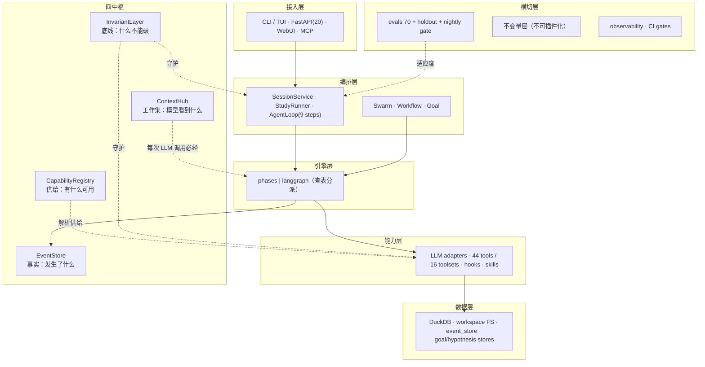
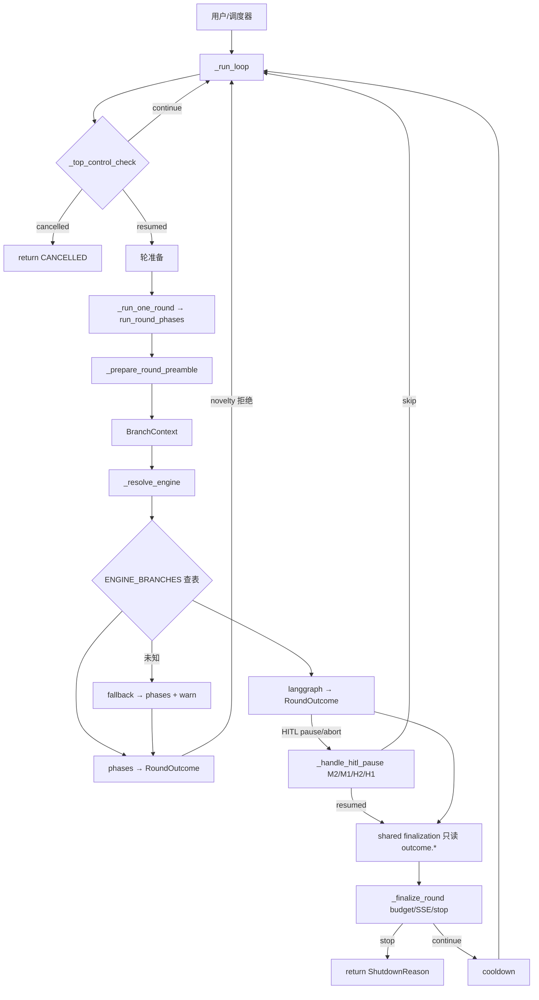
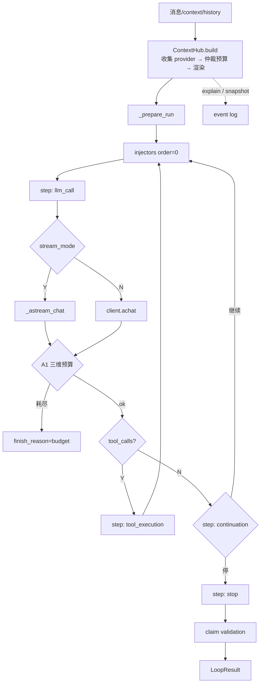
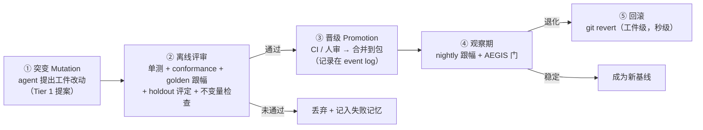

# 目标架构 v2 + RSI 定位 — 2026-10（讨论汇总）

> 输入：五遍评审（`architecture-reeval` / `architecture-reeval2` / `agent-design-reeval` / `goal-alignment-review` / `dsh-plugin-reeval`）+ 接缝规范（`plug-in-contract-design`）+ 中枢边界（`context-hub-membership-rule`）+ G1/G2 规格。
> 性质：**汇总设计**（行动项仍以 `refactor-master-plan-20261008.md` 为准，本文是其上位架构）。
> 新增议题：**RSI（递归自我改进）**——能否引入、放在哪、怎么不失控。

---

# 第一部分 · 目标架构 v2

> **总图**：`docs/architecture-v2-summary.svg`（六层 + 四中枢 + 三层接缝 + 三层基因组，一页看完）
> 下方 §1 是同内容的分块版（可编辑文本）

## 1. 一张总图



## 2. 四中枢的职责边界（一句话各一条）

| 中枢 | 回答的问题 | 唯一入口 | 明确不做 |
|---|---|---|---|
| **ContextHub** | 模型这次看到什么 | `build(query) → ContextBundle` | 不传输/不执行/不持久化/不控制流 |
| **CapabilityRegistry** | 有什么可用 | `resolve(kind, **criteria)` | 不含业务逻辑 |
| **EventStore** | 发生了什么 | `emit` / `subscribe` | 不做投影规则决策 |
| **InvariantLayer** | 什么不能破 | `register(installer)` | **不插件化、不可被插件覆盖** |

> 中枢之间的关系：**Registry 供件 → ContextHub 收集组装 → LLM 调用 → EventStore 记录 → InvariantLayer 守护全过程**。

## 3. 三层接缝规范（复用为主）

| 层 | 内容 | 状态 |
|---|---|---|
| L1 窄协议 | 29 个已有 + 补 3 个（`EventSource` / `ToolsetProvider` / `PersistenceContract`） | 复用 29，**不新建大协议** |
| L2 统一注册 | 扩展 `core/registry.py`（能力标签/依赖闭包/`validate`/`describe`） | 不新建平行注册表 |
| L3 一致性套件 | `tests/conformance/` 每协议一套可运行 pytest | 先 provider + data_loader |

## 4. 中枢成员规则（已定）

> **会改变模型输入的，才接中枢。**
> 直接接入仅 4 类：**贡献方 / 渲染器 / 工具区 / 历史区**。
> 其余（执行/编排/权限/传输/事件/持久化/策略）**不接入**，但其存在会出现在**统一快照**里（`providers_used` / `capabilities_available` / `events_ref`）——**可观测性达成，依赖不倒置**。

## 5. 两条主流程（架构图的可执行对照）

**Study 轮**（编排层）：



**Agent ReAct 轮**（能力层 + 上下文中枢）：



## 6. 与总计划的关系

本文**不新增行动项**，只固定架构终态。W0/W1/W2 九刀 + 0.9 不变量层仍是唯一起手顺序（见 `refactor-master-plan-20261008.md`）。

---

# 第二部分 · RSI：能不能引入？怎么不失控？

## 7. 先说结论

**可以引入，但只能引入「受限 RSI」，且必须满足三个前提：**

1. **只改行为工件，不改核心不变量**（预算/停止/状态机/scope —— 由 InvariantLayer 守护，agent 无权）
2. **每次改动都是「提案」，由评测门禁晋级**，agent 不能自我批准
3. **适应度必须是多维 + 有 holdout**（当前**没有 holdout** —— 这是最大的缺口，也是最该先补的）

> 强 RSI（系统改写自己的核心逻辑）**不做**：本项目的不变量、事务、状态机是正确性根基，交给「可被改写的代码」= 放弃正确性保证。

## 8. 两种 RSI 的分级（本项目可落地的范围）

| 形态 | 含义 | 本项目可行性 | 风险 |
|---|---|---|---|
| **L1 参数/提示自调** | 调 prompt 措辞、阈值、GA 参数 | ✅ **可做**，且已有一半设施 | 低（评测可门禁） |
| **L2 工件级自改写** | 改写自己的角色提示 / 技能 / 工具集组合 | ⚠️ **可做，但需人审晋级** | 中（reward hacking / 退化） |
| **L3 结构级自改写** | 改写自己的 step / 编排 / 核心逻辑 | ❌ **本阶段不做** | 高（正确性无保障） |

## 9. 三层基因组（什么可被自我改写）

现状事实（实测）：

| 工件 | 位置 | agent 现在能写吗 | 风险 | 归层 |
|---|---|---|---|---|
| 角色提示 `.prompts/*.md` | **包内** `src/strategy_research/templates/` | ❌ **写不到**（且 `workspace_setup` 明确把 `.prompts/` 排除在工作区外） | 高（直接决定 agent 行为） | **Tier 1 · 提案制** |
| 技能 `.skills/*.md` | 包内 | ❌ | 中 | Tier 1 · 提案制 |
| `strategy.py` / `config.yaml` / notes | **工作区** | ✅ 能写 | 低 | **Tier 2 · 自改**（这就是「研究产出」，非「自我进化」） |
| 因子代码 / 假设 | 工作区 + hypothesis store | ✅ | 低 | Tier 2（研究域） |
| 预算 / 停止 / 状态机 / scope | 核心 | ❌（结构保护） | — | **Tier 0 · 冻结** |

```
Tier 0  冻结核心      预算 · 停止 · 状态机 · scope · 不变量   —— InvariantLayer 守护，agent 无权
Tier 1  提案制行为工件 角色提示 · 技能 · 工具集组合            —— agent 提案 → 门禁晋级 → git 可回滚
Tier 2  可自改研究工件 strategy.py · config · notes · 因子    —— 今天就是研究产出，不是"进化"
```

> **注意**：Tier 2 已经是系统今天在做的事（agent 写策略、写因子）——那叫**产出**，不叫**进化**。真正的 RSI 是 Tier 1：系统改自己的**行为定义**。

## 10. 适应度函数（当前缺 holdout —— 必须先补）

现有评测资产：`evals/golden_tasks.jsonl`（70 题）· `evals/nightly-baseline.json`（基线）· `evals/scorecard.py`

现有指标：`mean` · `pass@0.7` · `steps_mean` · `tool_calls_mean`

| 要求 | 现状 | 动作 |
|---|---|---|
| **多维适应度** | ✅ 已有 4 维（质量/通过率/步数/工具调用数） | **规定「质量优先」，步数与工具调用数只能为辅**（否则系统会用「少走路」换分） |
| **回归基线** | ✅ nightly baseline + 跟幅门禁 | 沿用 |
| **holdout 集** | ❌ **没有**（全量可见 → reward hacking） | **必须新增**：一批 agent 不可见的任务，仅在晋级时评定 |
| **不变量参与适应度** | ❌ 未纳入 | 违反任一不变量 → **直接判负**（不参与打分） |

## 11. 突变—晋级—回滚三段式



**硬规则**：

| 规则 | 理由 |
|---|---|
| agent **只能提案**，不能自我批准 | 自我批准 = 无门禁 |
| 晋级需 **holdout + 不变量 + golden 三重过** | 防 reward hacking |
| **不变量违反 = 直接判负**，不参与打分 | 不能用「违反底线换分数」 |
| 每次晋级 **git 可 revert**，工件级秒级回滚 | 失败成本可接受才敢自改 |
| **Tier 0 永不进入基因组** | 核心正确性不交给可改写的代码 |
| 晋级记录进 **event log** | 演化史可审计、可回放 |

## 12. 防退化的四道闸（对齐已有资产）

| 闸 | 已有资产 | 作用 |
|---|---|---|
| **新颖性门** | `phase_engine._novelty_gate`（novel 提及 15） | 阻止「新版本只是旧版本微调/复读」 |
| **回归门** | `runner_aegis`（regress 提及 12） | 阻止「为过测而牺牲已有能力」 |
| **停滞/丢弃门** | `ShutdownReason.STAGNATION` / `DISCARD_STREAK` | 无进展就停，不无限自我迭代 |
| **不变量层** | 待建（主线 0.9） | 底线不可破 |

> 已有资产说明：**这个项目本来就是为自我改进设计的**——AEGIS 门禁、claims 可证伪、novelty/regression 检查、70 题 golden + nightly 跟幅，缺的只是「把工件纳入 genome + 加 holdout」两件事。

## 13. 落地方案（不新增主线，只加一条尾线）

| 阶段 | 内容 | 估工 | 前置 |
|---|---|---|---|
| **R0** | **建 holdout 集**（agent 不可见；20-30 题；只在晋级评定用） | **1d** | 无 |
| **R1** | **Tier 1 工件提案通道**：agent 可对 `.prompts/*.md` 提出 diff（写到工作区提案区，不直接改包） | 1.5d | 0.9 不变量层 |
| **R2** | **晋级门禁**：提案 → 三重评审（golden + holdout + 不变量）→ CI/人审 → 合并 | 2d | R0 + R1 |
| **R3** | **观察期与回滚**：晋级工件进 nightly 观察；退化自动 revert；演化史入 event log | 1d | R2 |
| **R4** | （可选）**结构级**自改写（自定义 step）——**仅在 L2 稳定运行半年后评估** | — | R3 |

**成本**：R0–R3 ≈ **5.5 天**，且**全部在主线之后**（不与 W0/W1/W2 抢资源）。

**先决条件**（不满足则不启动 R 线）：
1. W0 的不变量层已上线（否则自我改写没有底线）
2. holdout 集已建（否则无法判断是真进步还是过拟合）
3. 评测跟幅门禁稳定（否则会自毁）

## 14. 一句话

> **RSI 可以引入，但这里的正确形态是「受限自我改进」**：系统可以改自己的**行为工件**（提示/技能/组合），
> 改不了自己的**不变量**；每次改动是**提案**不是**决定**，由 **多维适应度 + holdout + 不变量门**裁决，
> 失败可**秒级回滚**。
>
> 而这个项目**已经是为自我改进造好的**——AEGIS 新颖性/回归门、claims 可证伪、70 题 golden + nightly 跟幅都已就位；
> 缺的只有两件：**holdout 集** 与 **工件纳入 genome**。
> 先补这两件，再谈自我进化——**顺序错了，RSI 就变成「自己给自己发奖状」**。
