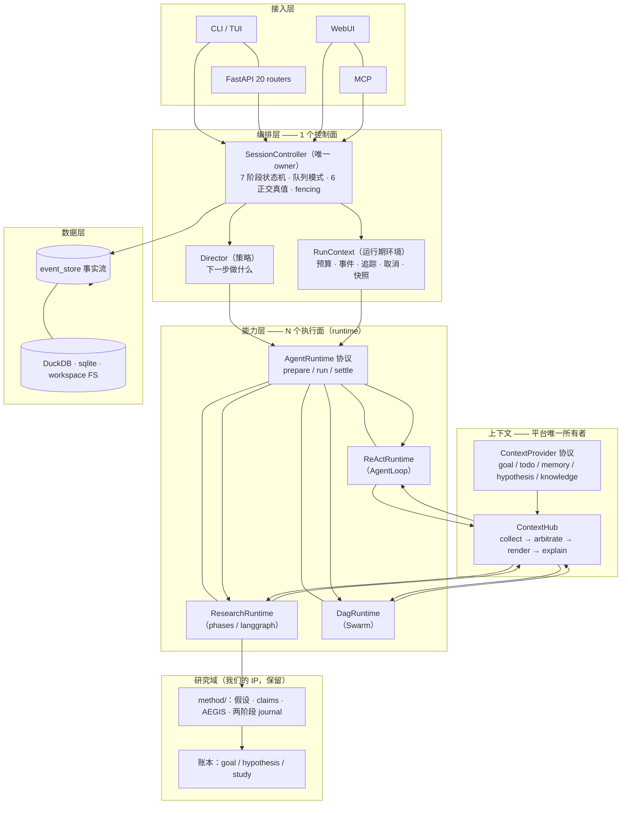

# 目标架构 v3（借鉴 OpenClaw）— 重新规划

> 性质：**架构总纲**，取代 `architecture-v2-and-rsi-20261008.md` 的分层部分；行动项仍以 `refactor-master-plan-20261008.md` 为准（本文件为其上位约束）。
> 依据：OpenClaw 架构对标（`industry-benchmark-openclaw-20261008.md` · `openclaw-architecture.html`）· 本仓四遍评审。
> 核心转变：**从「6 层 + 4 中枢」改为「1 控制面 + N 执行面 + 1 上下文所有者」**。

---

## 0. 一句话

> OpenClaw 的骨架 = **1 个控制面（Gateway）+ N 个可换执行面（harness）+ 平台独占上下文与策略**。
> 我们照搬这个骨架：**SessionController 唯一拥有「谁下一个可以跑」；AgentRuntime 协议让执行面可换；ContextHub 独占上下文装配与预算**；
> 而**研究方法论层（假设—证伪—AEGIS—两阶段 journal）原样保留为执行面的产物域**，不被稀释。

---

## 1. 目标架构



### 1.1 四个「唯一 owner」

| 关注点 | 唯一 owner | 其他人只能 |
|---|---|---|
| **谁下一个可以跑（turn 准入）** | `SessionController` | 提交请求（steer/followup/collect/interrupt） |
| **一次执行怎么做（模型循环）** | 具体 `AgentRuntime` 实现 | 声明能力与策略 |
| **模型这次看到什么（上下文 + 预算）** | `ContextHub` | 提供 item（`ContextProvider`） |
| **什么不能破（预算/停止/状态机/scope）** | 不变量层 | 无（插件无权覆盖） |

> 「一个 owner 对一件事」= OpenClaw 最值得抄的结构纪律。

---

## 2. OpenClaw 模式 → 我们的落法（逐条）

| # | OpenClaw 模式 | 借/不借/改造 | 我们的落法 | 批次 |
|---|---|---|---|---|
| 1 | **harness 可换**（codex/copilot/claude-cli + 选择序 + 声明式回退） | **借** | `AgentRuntime` 协议（prepare/run/settle）+ 选择器（model-scoped > provider-scoped > auto > 内置）；`role_factory`/`chat_loop` 收成**两个实现，不合并** | **P0** |
| 2 | **Session Controller 唯一准入**（7 阶段 + 队列模式） | **借** | 新建 `core/orchestration/session_controller.py`；chat 与 study 共用；**directive = steer**、**HITL pause = 准入闸**、**停因 = 终态+续轮决策** | **P0** |
| 3 | **6 个正交真值**（owned/admissible/active/injectable/abortable/settled） | **借** | `RunStatus` 从单一 `state` 改为 6 维；不用一个布尔表达一切 | **P0** |
| 4 | **fencing**（activeRunId + 提交校验） | **借** | run 级 `activeRunId`；被取代的 run 不得提交陈旧数据。**我们目前完全没有这条** | **P0** |
| 5 | **身份分离**（logical key ≠ incarnation ≠ operation ≠ attempt） | **借** | 新建 `core/orchestration/identity.py`；我们已有 NewType（session/attempt/message）但缺 incarnation/operation 层 | **P1** |
| 6 | **Prompt Assembly 平台独占**（provider 只贡献 3 个具名段） | **借** | `ContextHub` 独占装配；mixin/step/provider **不得自行拼 system prompt**；provider 贡献降级为「具名段」扩展点 | **P0** |
| 7 | **缓存边界**（稳定段在上 / 目录在下；刷新不改变前缀字节） | **借** | `ContextHub` 分「稳定前缀」与「易变目录」两区；目录刷新不改前缀 → KV cache 命中 | **P1** |
| 8 | **分层预算 + 归属**（per-attempt/provider/idle/总；谁产出谁拥有） | **借** | `core/context/budget.py`：三层超时 + 上下文预算归属到产出方 | **P1** |
| 9 | **插件版本协商**（compat/minHostVersion；不匹配即拒） | **借** | 29 个协议加 `PROTOCOL_VERSION`；不匹配**拒绝**，不降级 | **P1** |
| 10 | **CI import guards** 强制插件边界 | **借** | CI 门禁：core 禁 import api/cli；编排层禁 import runtime 内部；路由数 ≤ 12 | **P0** |
| 11 | **不变量独立于插件** | **借（我们更强）** | `core/invariants/`：Tier 0 冻结预算/停止/状态机/scope；他们的 sandbox 默认关，我们的冻结是默认 | **P0** |
| 12 | **一个调度器**（插件注册任务，宿主一个定时器） | **借** | 收敛 service/runner/scheduler 三处调度为 1 个；不持久化第二份调度状态 | **P2** |
| 13 | **状态版本化 + 迁移归属** | **借** | 沿用 `user_version`，补「迁移有 owner」；store 契约（真源/写入者/生命周期/幂等） | **P2** |
| 14 | **审计只投影元数据** | **借** | 快照只记元数据 + 账本指针，不复制 prompt/消息/工具结果 | **P1** |
| 15 | **记忆可归因清除 + 明示删除边界** | **借** | 自主研究会产大量记忆：补 retention/purge 语义 | **P2** |
| 16 | **20+ 渠道 / Nodes / 云 worker** | **不借** | 场景不同 | — |
| 17 | **单 Gateway 极简（一个人助理打天下）** | **不借** | 我们是多编排域（会话 + 研究 + DAG + 账本），是产品形态不是冗余 | — |
| 18 | **「一次 turn」式 loop** | **不借** | 我们的核心是多轮研究 | — |

---

## 3. 新包结构（目录级）

```
src/strategy_research/
├── core/
│   ├── orchestration/            ★ 新：通用控制面（与研究域无关）
│   │   ├── session_controller.py     7 阶段状态机 + 队列模式 + 6 正交真值
│   │   ├── run_context.py            预算/事件/追踪/取消/快照（唯一实现）
│   │   ├── director.py               策略接口：下一步做什么
│   │   └── identity.py               key / incarnation / operation / attempt
│   ├── runtime/                 ★ 新：执行面（可换）
│   │   ├── protocol.py               AgentRuntime 协议 + 选择器 + 回退声明
│   │   ├── react.py                  由 core/agent/loop.py 迁入
│   │   ├── research.py               由 core/study/phase_engine.py 迁入
│   │   └── dag.py                    由 core/swarm/runtime.py 迁入
│   ├── context/                 ★ 新：上下文面（平台独占）
│   │   ├── hub.py                    ContextHub（collect/arbitrate/render/explain）
│   │   ├── provider.py               ContextProvider 协议 + ContextItem
│   │   └── budget.py                 分层预算 + 归属
│   ├── invariants/              ★ 新：不变量层（Tier 0 冻结）
│   ├── agent/                   保留：能力件（tools/registry/skills/hooks/memory/llm adapters）
│   ├── study/
│   │   ├── method/               ★ 新：研究方法论（我们的 IP，从 phase_engine 抽出）
│   │   │   ├── hypothesis.py  claims.py  aegis.py  journal.py
│   │   ├── engine/               phases / langgraph 的执行细节
│   │   ├── runtime.py            research runtime 适配（实现 AgentRuntime）
│   │   └── store.py              study 账本
│   ├── goal/                    账本（目标/证据/矛盾）
│   ├── storage/                 存储层
│   └── ...                      其余不变
├── api/session/service.py      瘦身：只做 HTTP 适配，编排逻辑迁 orchestration/
└── api/routers/study.py        按面切模块（lifecycle / query / artifacts）
```

**迁移期兼容**：`core/agent/loop.py` 等旧路径保留 re-export 一个版本周期（对齐 OpenClaw 的 `doctor --fix` 迁移思路）。

---

## 4. 与既有主线的关系

| 原主线刀 | 处置 |
|---|---|
| 0.1 scheduler `_get_db` 泄漏 | **保留**（W0 先行） |
| 0.2 SSE 双轨收敛 | **保留**（W0） |
| 0.3 event_store 去反向 | **保留** |
| 0.4 持久化契约 | **保留**（升级为 13 号模式） |
| 0.5 CI 门禁 | **保留**，扩到「编排层禁 import runtime 内部」+ 协议版本 |
| 0.6 统一注册 | **保留** |
| 0.7 一致性套件 | **保留** |
| 0.8 ContextHub 试点 | **保留**，按 `core/context/hub.py` 定位 |
| 0.9 不变量层 | **保留**，定位 `core/invariants/` |
| 0.11 AgentLoop 移入能力层 | **改写**：终点是「成为 runtime」（`core/runtime/react.py`），不是搬目录 |
| 0.12 write fence | **保留**（升级为 SessionController 的一部分） |
| 1.1 假设工具 | **保留**（Director 的弹药） |
| 1.2–1.5 记忆/写回/propose_next/降级阶梯 | **保留**，但归位：1.4 → `orchestration/director.py` |
| 1.7 injector → provider | **保留**，协议落在 `core/context/provider.py` |
| 1.9 编排层收敛为 1 控制面 + N runtime | **升格为本文件的主线（见 §5）** |
| 2.1 统一估算 + 缓存边界 + 分层预算 | **保留**，落到 `core/context/budget.py` |
| 2.3 ContextPlan 裁剪 | **保留**，落在 `ContextHub.arbitrate` |
| 2.6 快照 fold | **保留** |

---

## 5. 新的实施分批

### P0 · 脊柱（4 周量级，可并行 2 人）

| 序 | 刀 | 内容 | 验收 |
|---|---|---|---|
| **A1** | `AgentRuntime` 协议 + 选择器 | `core/runtime/protocol.py`；`role_factory`/`chat_loop` 收成两个实现；声明式回退 | 换 runtime 只改配置；不支持则拒绝 |
| **A2** | `SessionController` 骨架 | 7 阶段状态机 + 队列模式（steer/followup/collect/interrupt）+ 6 正交真值 | chat 路径跑在新控制器上，行为等价 |
| **A3** | **write fence** | `activeRunId` 认领 + 提交事务校验 | 被取代的 run 提交被拒（有单测） |
| **A4** | `ContextHub` 骨架 + `ContextProvider` 协议 | 独占装配 + 唯一 token 账本；`validate()` 复活为强制门禁 | 1 个 provider 走通；上下文超限被拦 |
| **A5** | 不变量层 | `core/invariants/`：2 静态 + 1 运行时不变量 | 失败带 `code: 'INVARIANT'` |

### P1 · 收敛（3–4 周）

| 序 | 刀 | 内容 |
|---|---|---|
| B1 | **编排层收敛**：StudyLoop → Director + research runtime；Swarm → DagRuntime；SessionService 瘦身 | 
| B2 | 上下文第二阶段：缓存边界 + 分层预算 + 归属 |
| B3 | 协议版本化 + CI 门禁扩展 |
| B4 | 身份分离（incarnation / operation / attempt） |
| B5 | 记忆三改 + 写回（注入位置 / 出处 / 假设默认） |

### P2 · 研究域强化（与 P1 并行）

| 序 | 刀 | 内容 |
|---|---|---|
| C1 | 研究方法论归位 `core/study/method/`（假设 · claims · AEGIS · journal） |
| C2 | Director 落地：`propose_next` + 停因→动作映射 + 派生假设 |
| C3 | 失败降级阶梯（数据不可用 / 因子失败 → 换源 / 派生） |
| C4 | 记忆 retention / purge 语义 + 审计只投影元数据 |
| C5 | 单一调度器收敛（service / runner / scheduler 三处 → 1） |

### P3 · RSI（最后，前置全满足）

| 序 | 刀 | 内容 |
|---|---|---|
| D1 | holdout 集（agent 不可见） |
| D2 | Tier 1 工件提案通道（.prompts / .skills / 工具集组合） |
| D3 | 晋级门禁（golden + holdout + 不变量）→ CI/人审 → git 回滚 |
| D4 | 观察期与自动回滚 |

---

## 6. 风险与不做

| 风险 | 缓解 |
|---|---|
| **控制面统一是最大改动**（chat 路径迁移） | A2 先做**等价**迁移（不换语义），用 eval + 12k 测试守门；分两个 PR：先并行跑，再切流 |
| 研究语义被通用 session 稀释 | claims/journal/hypothesis 留在 `core/study/method/`，是 turn 的**产物**不是控制面 |
| 迁移期双路径漂移 | 旧路径 re-export 一个版本周期 + CI 门禁禁止新代码引用旧路径 |
| 范围膨胀 | P0/P1 不含任何新功能；新功能一律排在 P2/P3 |

**明确不做**：不写统一大协议 · 不合并 29 个协议 · 不插件化预算/停止/状态机 · 不拆 alpha_zoo（数据资产）· 不为 pyright 清零重写 mixin · 不引入 20 渠道/设备节点 · 不把研究轮降格成「普通 turn」而丢掉方法论。

---

## 7. 与目标的对齐检查（可验收）

| 目标 | 现状 | 目标 | 度量 |
|---|---|---|---|
| 一次工作只有一个 owner 驱动 | 3–4 套控制面 | **1**（SessionController） | 控制面模块数 = 1 |
| 执行面可换 | 硬编码 2 套工厂 | **N 个 runtime + 声明式回退** | 换 runtime 只改配置 |
| 上下文有唯一所有者与预算 | 4 builder + 5 injector 各自拼 | **ContextHub 独占** | `validate()` 恒过；超限被拦 |
| run 不会提交陈旧数据 | **无** | **fence 生效** | 取代 run 的提交被拒 |
| 协议可演进 | 无版本 | **版本化 + 不匹配即拒** | `PROTOCOL_VERSION` 覆盖全部协议 |
| 底线不可被插件改 | 分散 | **不变量层** | Tier 0 冻结项有测试背书 |
| **研究 IP 完整** | ✅ | ✅ **不动** | claims/journal/AEGIS 测试不降 |

---

## 8. 决策请求

1. **控制面统一为一个**是否接受？（chat 与 study 共用 SessionController；这是最大的一刀，也是最大简化）
2. **P0 是否 2 人并行**（A1 runtime 线 / A2-A5 控制面+上下文线）？
3. **P2 的研究域强化**是否与 P1 并行，还是等控制面稳了再动（避免同时改 phase_engine 与运行时）？
