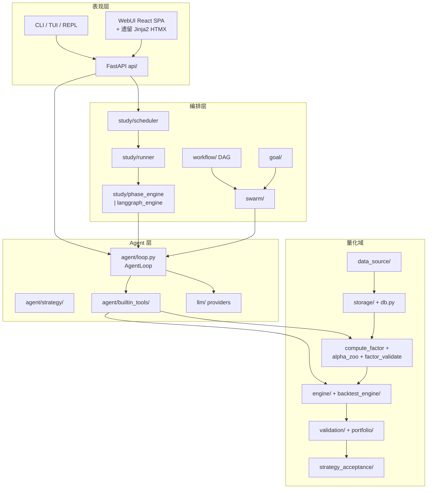

# 代码地图（code-map）

> 2026-09-21 · 全库梳理快照 · v0.6.0-dev  
> 范围：`src/strategy_research` + `webui` + `tests` + 根目录杂物

---

## 1. 体量

| 项 | 数 |
|---|---|
| 源码 py | 914 |
| 测试 py | 560 |
| 文档 md | 138 |
| 最大文件 | `agent/loop.py` 109KB、`api/session/service.py` 94KB、`core/autoresearch.py` 77KB |
| 测试 : 源码 | ≈ 0.93 : 1（architecture-review 口径 6,071 tests） |

版本不一致：`pyproject.toml` = 0.6.0，`src/__init__.py` = 0.3.0，git tag 最新 v0.5.0。

---

## 2. 分层结构



---

## 3. 量化域（core 下数据→因子→回测）

**主数据流**

`data_source`（8 loader + fallback 链）→ `data_import` → `db.py`/DuckDB(OHLCV) → `compute_factor` DSL 或 `alpha_zoo` → `factor_validate`（IC/6 维/去重）→ `config_runner` 合成信号 → `engine`（bar-by-bar）或 `backtest_engine`（Strategy/Callback 双路径）→ `backtest.py` runs + metrics → `validation`（MC/Bootstrap/WF）→ `portfolio` → `strategy_acceptance.decide`。

| 模块 | 职责 | 关键入口 |
|---|---|---|
| `data_source/` | 多源行情，Protocol+Registry | `base.py:23 DataLoader`、`registry.py:77 FALLBACK_CHAINS` |
| `storage/` | DataStore Protocol → DuckDB 适配 | `data_store.py:32`、`duckdb_store.py:27` |
| `db.py` | DuckDB 单文件事实库 | `register_factor:774`、`get_factors:846` |
| `compute_factor.py` | ~80 算子表达式 DSL + 解析器 | `evaluate_expression:1253`、`analyze_complexity:968` |
| `factor_validate.py` | IC/IR、6 维评分、Mutual IC | `validate_factor:395` |
| `alpha_zoo/` | 5 库 ~470 因子（py+yaml 成对） | `loader.py:16 compute_alpha` |
| `engine/` | 多市场 bar-by-bar | `runner.py:276 run_engine_backtest` |
| `backtest_engine/` | 统一回测 Protocol | `protocol.py:37`、`factory.py:76` |
| `validation/` | MC / Bootstrap / Walk-forward | `runner.py:22 run_validation` |
| `strategy_acceptance/` | 硬阈值 + 可选 LLM 准入 | `decide()` |

**统一模式**：Protocol + Registry + Adapter（DataLoader / DataStore / BacktestEngine 三处同构）。

---

## 4. 编排与 Agent

**典型研究链**

`StudyScheduler` → `AutoresearchRunner._run_one_round` → `run_round_phases`（phase_engine 或 langgraph_engine）→ `spawn_agent` → `role_factory.run_agent_via_llm` → `AgentLoop` → builtin_tools → AEGIS 门禁 / claims 校准 → 评估 → 预算与 goal 判定。

| 模块 | 职责 | 备注 |
|---|---|---|
| `agent/loop.py` | ReAct 主循环 + hooks + 沙箱 | 2400+ 行，全库中枢 |
| `agent/strategy/` | LoopStrategy = 9 个 Step 组合 | Minimal / Explorer / Validator 变体 |
| `study/` | 长程多轮研究 | 双引擎：phase vs langgraph；`engine='dag'` 静默映射到 langgraph |
| `workflow/` | 可审批 DAG | 与 goal/workflow 并行两套 |
| `swarm/` | DAG 分层并行多 agent | presets/ 35 套 YAML |
| `goal/` | 目标工作流 | 已委托 SwarmRuntime |
| `hypothesis/` | 假设注册（JSON） | loop 自动建假设 |
| `llm/` | OpenAI 兼容客户端 | provider/ 适配器 + fallback |
| `mcp/` | 只读研究工具 MCP | 复用 agent tool registry |

**双重实现（收敛建议点）**
1. phase_engine ↔ langgraph_engine（dag 假选项）
2. chat_loop ↔ role_factory 两套 AgentLoop 构造
3. goal/workflow ↔ workflow/executor 两套 DAG
4. sandbox/legacy.py 能力实际仍在 legacy，StaticSandbox 未接管
5. chat.py ↔ web_session.py SessionService/EventBus 接线重叠

---

## 5. 表现层

**API**：`api/app.py:22 create_app`，约 22 个 router 全挂 `/api/*`。事件溯源现行链：`core.agent.event_store` → `bridge_v2` → `sse_buffer`（Last-Event-ID 回放）→ `projector` 物化 messages。`events.py` / `event_bus_v2.py` 已标 deprecated。

**CLI** 调度矩阵（`cli/__main__.py`）：
- TTY 裸调用 → Textual TUI
- `--repl` / `--banner` → prompt_toolkit REPL
- 子命令 / 非 TTY → argparse（~19 子命令）

**WebUI 双前端**：
- 主：`webui/frontend/` React 19 + Vite + TS + Tailwind + zustand + SSE hooks
- 遗留：`src/strategy_research/webui/routes.py` Jinja2 + HTMX（prefix `/webui`）

**tests**：537 个扁平 `test_*.py` + `attic/` 12 退役 + `_fixtures/` 8 共享。CI：3.10–3.12 矩阵 + ruff + Playwright e2e。

---

## 6. 技术债与仓库卫生

| 优先级 | 项 | 位置 |
|---|---|---|
| P0 Bug | `registry.keys()` 返回 `(k,v)` 元组而非键名 | `data_source/registry.py:50` |
| P0 | 版本号三处不一致（pyproject 0.6.0 / `__init__` 0.3.0 / tag v0.5.0） | |
| P1 | 根 `templates/` 是漂移副本（缺 `.prompts/`，若干文件哈希不同），代码只用 `src/.../templates/` | 建议删除或同步 |
| P1 | 三套 backtest 模型并存 | `core/backtest_models.py`、`utils/backtest_models.py`、`engine/models.py` |
| P1 | `agent/loop.py` / `api/session/service.py` / `core/autoresearch.py` 巨型文件待拆 | |
| P2 | alpha_zoo 新旧 loader 并行（`loader.py` vs `alpha_zoo_adapter/convert/yaml`） | |
| P2 | 前端 Study API 死端点 16 个 | 根 `UNUSED` 清单 |
| P2 | 双前端 + 双事件桥（events / event_bus_v2 标 deprecated 仍在） | |
| P3 | 根目录 `analysis/`、未跟踪 PDF、`install.py/sh` 归属 | `analysis/` 未 ignore |
| P3 | `study/_archived/`（Temporal 五件套等）已隔离，可择期删 | |

---

## 7. 未提交工作（当前工作区）

「因子入库纪律 / 复杂度约束门」（QuantaAlpha 风格）：
1. `compute_factor.analyze_complexity` — 算子数 / 自由参数 / 特征数加权分
2. `db.register_factor` — 自动复杂度分析，解析失败 fail-closed；factor_registry 增 6 列（复杂度 4 + `info_channel` + `parent_hypothesis_id`），旧库 `_ensure_factor_registry_columns` 迁移
3. `factor_validate.compute_mutual_ic` — 由首日截面改为逐日 Spearman 均值
4. tests：`test_factor_registry_discipline.py`（新）+ `test_factor_validate.py` 扩充；prompts 同步

涉及文件 8 个（+322/−24），另未跟踪 `UNUSED`、`analysis/`、docs PDF 2 份。

---

## 8. 一页速查

```
strategy_research/
├── core/          量化域 + Agent + 编排（主战场）
│   ├── data_source/ storage/ engine/ backtest_engine/
│   ├── alpha_zoo/ compute_factor factor_validate db backtest
│   ├── agent/     loop, strategy, builtin_tools, sandbox
│   ├── study/     scheduler, runner, phase|langgraph, aegis
│   ├── workflow/ swarm/ goal/ hypothesis/
│   └── llm/ memory/ hooks/ validation/ portfolio/
├── api/           FastAPI + session 事件溯源 + SSE
├── cli/           TUI / REPL / argparse
├── templates/     真源（打包）
└── webui/         routes.py（遗留 HTMX）
webui/frontend/    React SPA（主前端）
tests/             537 + attic + _fixtures
```
