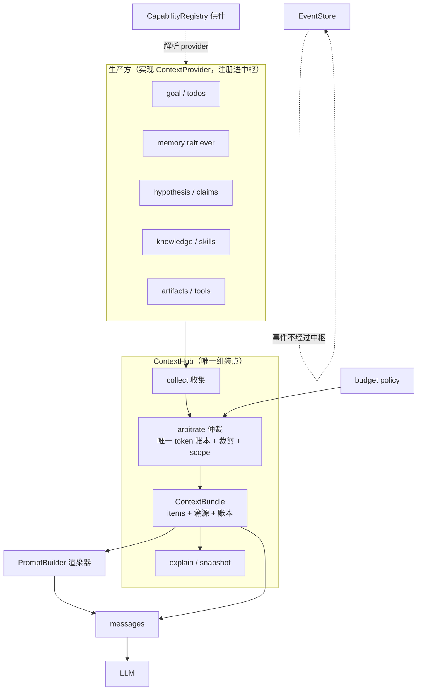

# 上下文中枢（Context Hub）— 讨论稿

> 性质：**讨论稿**，含待拍板的开放问题。非实施规格。
> 关联：`plug-in-contract-design.md`（接缝三层）· `agent-g1-g2-design.md`（ContextPlan 预算）· `refactor-master-plan-20261008.md`（主线）
> 命题：上下文管理协议可作为**核心中枢之一**，其他范式接入此处。

---

## 1. 为什么「上下文」是合适的中枢

| 判据 | 成立？ |
|---|---|
| 多生产方 → 单消费方 | ✅ 记忆/目标/待办/假设/知识/工具/工件 → 一次 LLM 调用 |
| 它是「工作集」 | ✅ 其他接缝最终都以「文本进入 prompt」影响 agent 行为 |
| 每次交互必经 | ✅ 每次 LLM 调用都要过它 → 天然是拦截点（预算、溯源、注入点都在这） |
| 能被观察 | ✅ 能解释「模型为什么这么答」——当前完全做不到 |

**但**：它是**中枢之一**，不是全部中枢。另外两个中枢：
- **能力目录**（`CapabilityRegistry`）——「有什么可用」
- **事件总线**（`EventStore`）——「发生了什么」

三者关系：**目录供件 → 事件记录 → 上下文组装 → LLM**。

---

## 2. 必须避免的失败模式

中枢最容易变成上帝对象。三条硬约束：

| 约束 | 反例（我们刚犯过的） |
|---|---|
| **中枢只依赖协议，不 import 生产方** | `event_store` import `projector` → 反向依赖 |
| **中枢不做业务判断** | 中枢不该知道「假设比记忆重要」——那是 provider 的 `priority` 声明 |
| **中枢不持有会话状态** | 状态在 provider 侧（记忆库/目标库），中枢只做无状态组装 |

> 一句话：**生产方注册进中枢，中枢从不 import 生产方。**

---

## 3. 中枢需要的功能（从本项目证据反推）

### A. 贡献面（生产方实现）

```python
@dataclass(frozen=True)
class ContextItem:
    id: str
    kind: str            # goal|todo|memory|hypothesis|skill|knowledge|artifact|tool_result|history
    content: str
    source: str          # 溯源：provider 名 + 定位（db/表/文件:行）
    created_at: str      # ISO 时间 → 模型可判断新鲜度
    confidence: float    # 0..1
    scope: str           # session|study|goal|global → 跨域不串
    priority: int        # 同 kind 内相对重要度（降级用）
    tokens: int          # 预估（中枢统一口径）
    meta: dict           # 附加

class ContextProvider(Protocol):
    name: str
    scopes: frozenset[str]                 # 该 provider 产出属于哪些域
    def provide(self, query: ContextQuery) -> list[ContextItem]: ...
```

`ContextQuery` 需携带：`task_text` · `session_id` · `study_id` · `goal_id` · `iteration` · `phase` · `budget_hint` · `prior_kinds`（避免重复贡献）。

### B. 仲裁面（中枢独占）

| 功能 | 对应现存问题 |
|---|---|
| **唯一 token 账本** | 现在 3 套估算（`//4` / `3.0` / token_utils） |
| **不可裁区** | system prompt / tool schemas 永不裁 |
| **裁剪序** | 固定序：tool_result → history 中段 → injected（按 provider priority 倒序） |
| **scope 隔离** | study/goal 的内容不进 chat session |
| **敏感标记** | provider 可声明 `sensitive`，渲染时降级或遮蔽 |

### C. 渲染面

- 中枢产出 **`ContextBundle`**（items + 分区 + 账本 + 溯源）
- **渲染器**独立（复用现有 `PromptBuilder` 协议）：`bundle → messages`
- 分区建议：`system 区` / `上下文区`（goal/hypothesis/knowledge） / `工具区`（schema） / `历史区`

### D. 溯源与可证伪面（**本项目特色**）

- 每条 item 带 `source/created_at/confidence` → 模型能判断「这是旧知识/这是本次结论」
- **`explain()`**：本次保留了什么、丢了什么、为什么 → 调试 agent 行为的第一手材料
- **`ContextSnapshot`**：一次调用的完整上下文快照（可 JSON 化）→ **可回放、可对比、可评测**
  - 直接服务「评测即护栏」：改 prompt/工具/记忆后，能 diff 两次运行的上下文差异

### E. 可观测面

- 每 provider 贡献量（条数/tokens）、被裁条数、耗时 → trace 事件
- 与 G1 的 `ContextPlan.explain()` 合并为同一份

---

## 4. 与现有扩展面的关系（收 / 留 / 转）

| 现有 | 处置 | 说明 |
|---|---|---|
| 5 个 injector | **转为 provider**（适配器） | `inject_pre_run` / `inject_per_iteration` → `provide()`；`inject_post_response` **不转**（它返回 bool = 控制决策，不是上下文） |
| `PromptBuilder`（协议已有） | **留，成为渲染器** | 4 个实现可合并（见 G6） |
| toolset | **留**，作为「工具区」供给 | 未来 `ToolsetProvider` 决定 schema 集 |
| `compact.py`（832 行预算引擎） | **留**，降级为「兜底压缩」 | 中枢裁剪是第一道，压缩是第二道 |
| `budget.py` | **留**，提供 token 预算 | 中枢消费它，不自己算钱 |
| `EventStore` | **留**，是事件面不是上下文面 | 通过 `EventSource` 协议接入 |

> **原则**：中枢**不新造**机制，只把散落的「加上下文」动作收敛成一个入口。

---

## 5. 数据流（中枢在系统中的位置）



---

## 6. API 草案

```python
class ContextHub:
    def __init__(self, *, budget_policy, renderer_factory): ...

    # ── 注册（生产方侧）──
    def register(self, provider: ContextProvider) -> None

    # ── 组装（消费方侧，每次 LLM 调用一次）──
    def build(self, query: ContextQuery, *, history: list[dict], tools: list[dict]) -> ContextBundle:
        items = self._collect(query)          # 各 provider 贡献（best-effort，异常不阻断）
        items = self._arbitrate(items, query) # 预算 + scope + 裁剪
        return ContextBundle(items=items, history=history, tools=tools, accounting=...)

    def render(self, bundle: ContextBundle) -> list[dict]: ...
    def explain(self, bundle: ContextBundle) -> dict: ...
    def snapshot(self, bundle: ContextBundle) -> dict: ...   # 可 JSON 化，用于回放/对比
```

**不变式**：
1. `bundle.total_tokens <= budget` 恒成立
2. `bundle.validate().ok` 恒 True（复用现成的 `ValidationResult` 契约，**把它从死契约变成活门禁**）
3. 同 query + 同 provider 状态 → 同 bundle（确定性，便于回归）
4. 中枢不抛异常给调用方（provider 故障降级为「无贡献」并记日志）

---

## 7. 与主线的合并

| 波 | 刀 | 内容 | 估工 |
|---|---|---|---|
| W0 | 0.8 | `ContextItem` + `ContextProvider` 协议 + `ContextHub` 骨架（**只收 1 个 provider 做试点**：goal） | **1.5d** |
| W1 | 1.7 | injector → provider 适配（goal/todo/memory 三类）；**记忆注入三改**（位置/出处/假设默认）并入此处 | 1.5d |
| W2 | 2.2 | **ContextPlan 并入中枢仲裁面**（不再单独存在）；影子模式 → 开启裁剪 | 2.5d |
| W2 | 2.6 | `ContextSnapshot` + eval 上下文 diff | 1.5d |

> **G1 的 ContextPlan 不再是独立模块**——它就是中枢的仲裁面。这样少一个概念。

---

## 8. 待拍板的开放问题（5 条）

1. **中枢是否拥有渲染？**
   建议：**不拥有**。中枢产出 `ContextBundle`，渲染由 `PromptBuilder` 协议的实现做。理由：渲染有多种（chat / study / swarm），中枢不应内置。

2. **scope 模型的粒度**：`session / study / goal / global` 四级够吗？`task`（单次 run）要不要单列？

3. **裁剪默认序**：建议 `tool_result → history 中段 → injected`；但**注入的 goal/hypothesis 优先级应高于 history**——是否认可「目标与假设不可丢」为硬规则？

4. **记忆/历史是 provider 还是中枢内建？**
   建议：记忆是 provider（可替换）；**历史是中枢内建**（它不是「检索」出来的，是本轮对话本身）。

5. **是否要 `ContextSnapshot`（可回放/可对比）？**
   建议**要**。它是「评测即护栏」的前提：改 prompt/工具/记忆后 diff 上下文差异，能把「行为变化」归因到「上下文变化」。成本 1.5d。

---

## 9. 一句话

> 上下文中枢的价值不在「再包一层」，而在**把散落的「加上下文」动作收敛成一处，并第一次让上下文可解释、可回放、可评测**。
> 成败关键只有一条：**中枢只依赖协议，绝不 import 生产方**——否则它就是下一个上帝对象。
