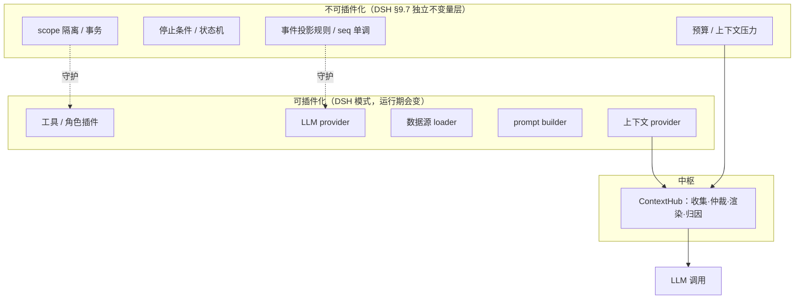

# 架构师重估（DSH 视角）— 「一切都是插件」是否该借

> 问题：是否借鉴 DSH（DeepSeek Harness）**一切都是插件**的逻辑。
> 证据：`docs/deepseek-harness-research.md`（DSH 调研）· 代码实读（`core/registry.py` `core/events/event_v2.py` `core/agent/tools.py` `core/agent/loop.py`）· 本仓 DSH 借鉴点全量清单。

---

## 0. 结论

**该借，但 DSH 自己就不是「一切都是插件」——它有明确保留。**

> DSH 的原话：**「Cordis 本身不含任何 agent 逻辑，所有 agent 行为来自插件」**；
> 但 DSH 同时有 **`ctx.invariants.register(...)`（§9.7）**——**不变量是独立于插件的一层，插件改不了它**。

所以要借的是这条：

> **行为可插件化；不变量必须留在结构里，插件无权覆盖。**

而且——**我们早就借了 8 成**。这不是「要不要借」的问题，是「借到哪为止」的问题。

---

## 1. 本仓已借的 DSH 模式（实测清单）

| # | DSH 模式 | 本仓落点 | 状态 |
|---|---|---|---|
| 1 | 通用注册表（替代散落 dict） | `core/registry.py`（DSH-inspired 自陈，替代 8+ 个 ad-hoc dict） | ✅ |
| 2 | 可插拔上下文注入 | `core/agent/context_injector.py`（5 个 injector） | ✅ |
| 3 | 转向注入（steering inbox） | `core/agent/loop.py`（DSH-inspired steering inbox） | ✅ |
| 4 | 单调拒绝守卫 | `core/agent/tools.py::ToolGuard`（只能拒、不能强放） | ✅ |
| 5 | Prompt 自动发现 | `core/agent/prompt_builder.py`（`templates/.prompts/*.md` 扫描） | ✅ |
| 6 | 作用域工具 + 守卫管道 | `core/agent/tools.py`（scoped tools + guard pipeline） | ✅ |
| 7 | 插件 entry_points 发现 | `core/agent/builtin_tools/__init__.py` | ✅ |
| 8 | 请求信封（每次 LLM 调用记 system prompt + tool schema） | `core/events/event_v2.py::LLM_REQUEST` | ✅ |
| 9 | 会话查询模式 | `api/routers/chat.py`（读 trace 事件） | ✅ |
| 10 | 上下文 order 分带 | injector 的 `order`（-100/-90/0/100）≈ DSH `PromptSection.order` | ✅（同构） |

**未借的（DSH 有、我们没有）**：

| # | DSH 模式 | 价值 |
|---|---|---|
| **A** | **不变量注册层（§9.7）** | 把散落的护栏（import 方向门禁、行数门禁、eval 跟幅、语义红线、tool 配对、单调 seq）收敛成**一层可注册、可编码失败的检查** |
| **B** | **Profile / Bundle / Patch（§2.3）** | 「任意配置行可被 patch 覆盖，无需改源码」——比我们的 toolset/preset 更强 |
| **C** | **Surface 作为模型历史唯一来源（§3.4）** | 我们的 event_store → projector → messages 路径与之类似，但**未做到「唯一来源」**（messages 与 projector 双写） |

---

## 2. DSH 的插件到底插件化了什么（关键判据）

DSH 的插件（Cordis）只服务**三类**东西：

| 类别 | DSH 例子 | 共同特征 |
|---|---|---|
| **能力提供** | filesystem / subprocess provider、tool provider、LLM adapter | 运行期**真的会换**（换沙箱、换模型、换工具） |
| **行为扩展** | prompt section、context injector、guard、sub-agent | 加了不影响核心正确性 |
| **组合打包** | bundle / profile / patch | 组织形态，不是行为 |

**DSH 没有插件化的**（因为它们是「错了就错」的不变量）：

- 预算与上下文压力策略（DSH §3.6 是**core 内部实现**，不是插件）
- 事件序号单调性、turn/step 边界、tool call/result 配对（→ §9.7 **独立不变量层**）
- Surface 投影规则（3 种事件类型决定哪些进 LLM 消息——这是 core 语义）

> **判据**：**运行期真会变 + 变错不致命** → 可插件化；**错了就错** → 必须留在结构里、由不变量层守护。

---

## 3. 映射到本仓：哪些该插件化、哪些绝不

| 本仓部件 | 判定 | 依据 |
|---|---|---|
| 工具 / 插件角色（`AgentPlugin`） | ✅ 已是插件 | 运行期会换（角色 preset 35 套） |
| LLM provider adapter | ✅ 已是插件（`_REGISTRY`） | 换 provider 不改核心 |
| 数据源 loader | ✅ 已是插件（`DataLoader` + registry） | 换源 + fallback 链 |
| prompt builder | ✅ 已是协议 | 换角色 prompt |
| 上下文 provider | ✅ 应为插件（中枢成员规则） | 新增来源 |
| **预算 / 停止条件** | ❌ **绝不插件化** | 「不超支」「必停」是硬不变量；插件化 = 可被配置改掉 |
| **状态迁移（study/goal 状态机）** | ❌ **绝不插件化** | 迁移合法性是正确性 |
| **scope 隔离 / 事务** | ❌ **绝不插件化** | 数据边界 |
| **事件序号 / 投影规则** | ❌ **绝不插件化** | 与 DSH 一致 |

---

## 4. 由此修正我上一轮的两处设计（DSH 给了更优解）

### 4.1 修正一：`ContextSnapshot` **不新建存储**，改为**从事件日志 fold**

| | 我上一版 | DSH 做法（§3.5 + §9.11） |
|---|---|---|
| 快照存哪 | **独立 snapshot 存储**（新增子系统） | `request/header` 事件进 **session log** → `foldRequestHeader(events)` 重建 |
| 代价 | +1 存储 +1 API +一致性风险 | **0 新存储**（事件日志已有） |
| 额外收益 | 上下文 diff | DSH 用它做**审计 + KV-cache 失效预测 + 崩溃恢复**；我们可用它做**行为变化归因** |

**我们的 `LLM_REQUEST` 事件已经记录 `system_prompt` + `tools_schema`** → **快照能力其实早就有，只是没被当作归因工具用**。

> 修正后 2.6 成本从 **1.5d → 0.5d**，且**少一个子系统**。

### 4.2 修正二：`CapabilityRegistry` **不新建**，扩展既有 `core/registry.py`

`core/registry.py` 已是 DSH-inspired 通用注册表基类（92 行，含 lookup/iterate/filter/restricted）。
**我上一版另起 `CapabilityRegistry` = 第 6 套注册表**——讽刺且违背「减成本」。

> 修正后 0.6 = 给 `Registry[T]` 加**能力标签 + 依赖闭包 + validate + describe** 四个能力（特化，不是平行类）。成本 1d → 0.5d。

### 4.3 新增：借 DSH 的**不变量注册层**（DSH §9.7）——唯一真正没借的

```python
# core/invariants/  （不依赖任何插件）
ctx.invariants.register(pkg_name, installer)   # 返回注销函数
# 失败带 code，例如 code: 'INVARIANT'
```

**为什么值得借**：我们现在的护栏是**散落的**——CI 门禁（import 方向 / 路由数 / 行数）、pyright 回归门禁、eval 跟幅、语义红线（ARCHIVED/M2/M1/H2/H1）、tool call/result 配对、单调 seq。DSH 的做法是**一层可注册、可编码失败的检查**，且**明确独立于插件**。

**这恰好补上我反复说的「中枢/插件不能破坏不变量」**——用结构表达，而不是靠 review 自觉。

| 可注册不变量（我们已有的） | 落地方式 |
|---|---|
| `core→api` 反向 import = 0 | 静态检查（进 CI 门禁） |
| 单文件路由 ≤ 12 / 上帝服务 ≤ 12 | 静态检查 |
| tool call ↔ tool result 配对 | 运行时检查（`code: 'INVARIANT'`） |
| 事件 seq 单调 | 运行时检查 |
| 语义红线（5 条） | 契约测试（已有）+ 注册为不变量名 |
| eval 跟幅 | 独立门禁（已有） |

---

## 5. 最终设计立场



**三条规矩**：

1. **行为可插件，不变量不可插件**——不变量层独立，任何插件无权覆盖
2. **中枢只依赖协议**——不 import 生产方（见 `context-hub-membership-rule.md`）
3. **快照从事件日志派生**——不新增存储（DSH §9.11：replay 是原生能力，不是独立工具）

---

## 6. 对主线的修订（净变化：两处减、一处加）

| 原刀 | 修订 |
|---|---|
| 0.6 统一注册 | **改为扩展 `core/registry.py`**（加能力标签/依赖闭包/validate/describe），不新建平行注册表 → **0.5d** |
| 0.7 一致性套件 | 不变（1d） |
| 0.8 中枢试点 | 不变（1.5d） |
| 1.6 EventSource 协议 | 不变（0.5d） |
| 2.6 ContextSnapshot | **改为「从 `LLM_REQUEST` 事件 fold + eval diff 报告」**，不建存储 → **0.5d** |
| **新增 0.9** | **不变量注册层**（`core/invariants/`）：先收 2 个静态不变量（import 方向 / 路由数）+ 1 个运行时不变量（tool call/result 配对）→ **1d** |

**净变化**：总成本 **-1.5d**，子系统 **-1**（无独立快照存储），新增 **+1d**（不变量层）→ **净 -0.5d**，且护栏从散落变为**一层可注册、可编码失败**。

---

## 7. 一句话

> **DSH 的「一切都是插件」可以借，但必须连它的保留一起借：行为可插件，不变量独立于插件。**
> 我们已借 8 成，**唯一还值得借的是「不变量注册层」**；而 DSH 反而帮我**砍掉了**两个设计（新快照存储、新注册表）——
> 这就是读对参照系的价值：**它不是让你加东西，是让你少加东西。**
