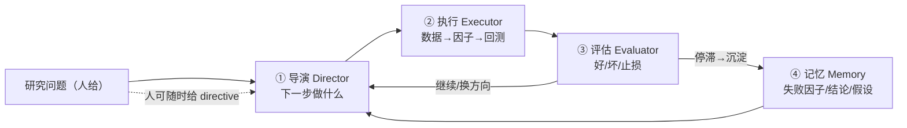
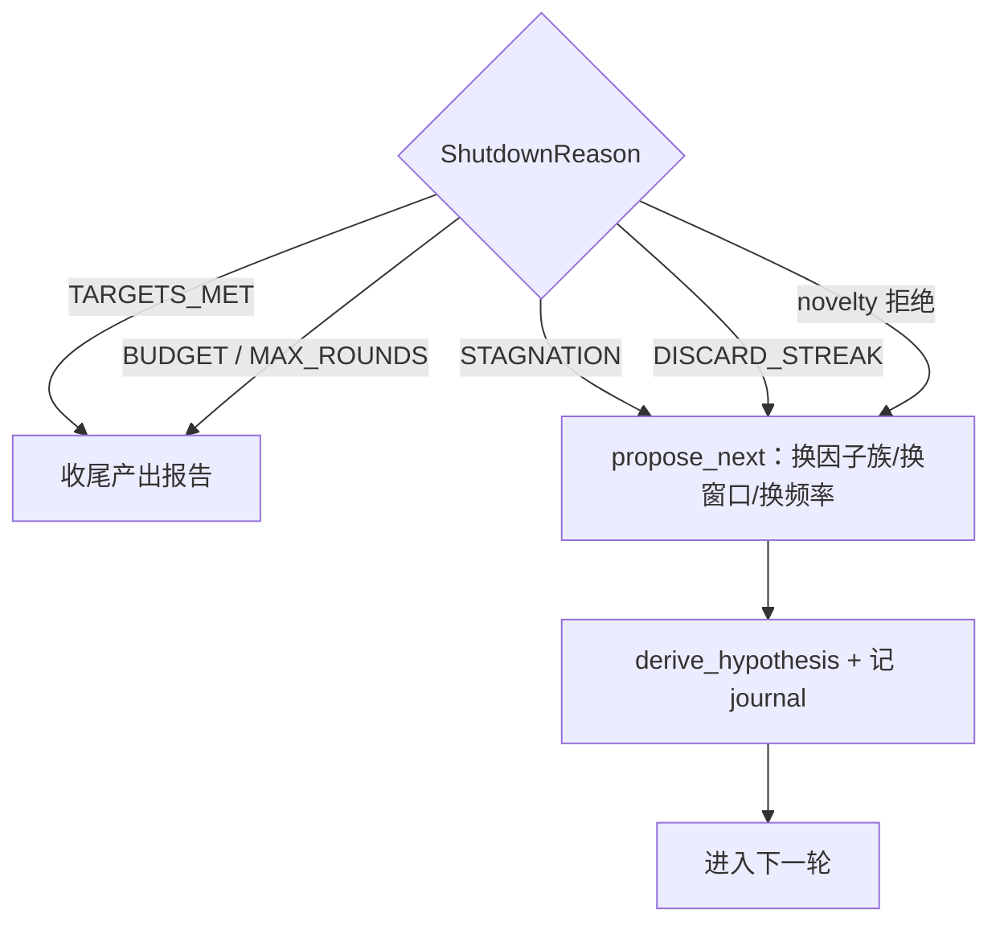
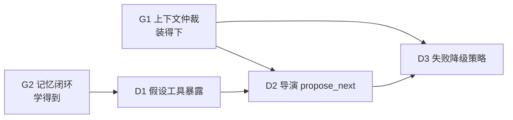

# 目标对齐审视 — 「能自主处理各种问题的量化研究 agent」

> 视角：按**产品目标**而非代码质量审视架构。
> 目标定义（用户原话）：「帮助我做量化研究的一个智能 agent，最好能自行处理各种问题」。
> 证据：工具面 43 个（角色化）、ShutdownReason 9 类、AEGIS 2 门、phase_engine 13 个 agent 驱动阶段、directive/hypothesis 触达统计。

## 0. 结论

**当前系统是一个优秀的「自主执行器 + 自主评估器」，但没有「自主导演」。**

| 层 | 目标要求 | 现状 | 判定 |
|---|---|---|---|
| **执行** | agent 自己把一轮跑完 | 43 工具角色化覆盖数据→质量→因子→策略→回测→归因→评审 | ✅ 完整 |
| **评估** | agent 自己判断好坏并止损 | 9 类 ShutdownReason + novelty/regression AEGIS 门 + claims 可证伪 | ✅ 强，且是差异化资产 |
| **记忆** | 跨轮/跨会话积累 | agent 不写记忆；只在 pre-run 注入一次；注入位置错 | ❌ 断（G2） |
| **导演** | agent 自己决定下一步研究什么 | **无 propose 语义**；hypothesis 域模型有 `create/derive/contradicts` 但**未暴露为工具**；directive 只有格式化没有产生 | ❌ **最大缺口** |

> 一句话：**这台风车能把给定任务做到很好，但没人告诉它下一台风车该造什么的时候，它不会自己决定。**

## 1. 目标拆解：自主研究 agent 的四段

**现状**：②③ 自动化程度高，④ 断裂，**① 基本靠人**。

## 2. 逐层证据

### 2.1 执行层（✅ 完整，无需动）

角色化工具集实测覆盖完整研究链：

| 角色 | 工具 |
|---|---|
| data_quality | `get_market_data` `list_data_sources` `check_data` `clean_data` `run_bg_command` |
| researcher | `read` `list_history` `factor_analysis` `websearch` `webfetch` `search_symbol` `show_chart` |
| factor_analyst | `compute_factor` `factor_analysis` `factor_cross_sectional_analysis` `factor_quintile_returns` `factor_ic_decay` `factor_turnover` |
| strategist | `read` `write` `run_backtest` `git_diff` `show_report` |
| risk_controller / attribution_analyst / anti_overfit_analyst / critic / planner / evaluator / study_reviewer / study_collector | 各自职责 |

### 2.2 评估层（✅ 强，是护城河）

`ShutdownReason` 9 类：`TARGETS_MET` `MAX_ROUNDS` `BUDGET` `STAGNATION` `DISCARD_STREAK` `EARLY_STOPPED` `REPEATED_DEVIATION` `REVIEW_FAILED` `CANCELLED`；
AEGIS 门 2 个：`_check_novelty` `_check_regression`；
phase_engine 13 个 agent 驱动阶段（含 `_novelty_gate` `_run_review_cycle` `_capture_round_claims` `_record_journal_and_regression`）。

**这一层已经具备「自己判断、自己止损」的能力**，是普通 chat agent 不具备的。

### 2.3 导演层（❌ 缺口，本次核心发现）

| 探针 | 结果 | 含义 |
|---|---|---|
| `runner.py` 中 `next_round` / `propose` / `plan_next` / `_flush` | **0 / 0 / 0 / 0** | 循环**没有「提出下一步」这个动作** |
| `runner.py` 中 `directive` 23 处，但只有 `_format_directives` 一个生产者级函数 | — | directive **只被读取/格式化**，无人（人或 agent）产生 |
| `HypothesisRegistry` / `HypothesisStore` 提供 `create` `derive` `link` `contradicts` `list_contradictions` | 域模型**已具备**自主研究方向的原语 | 但**没有任何工具暴露给 agent** |
| 工具清单中与「方向」相关的只有 `create_goal` `complete_goal` `list_goals` `get_goal_status` | — | 只能建目标，**不能派生假设/表达矛盾** |
| `phase_engine` 的阶段由 `_prepare_round_preamble` 装配，方向来自人给的 directive/objective | — | 人在扮演策略师 |

**关键结论**：**领域模型已经能表达「派生新假设」「标注与旧假设矛盾」，但 agent 的工具面没有把它暴露出来。** 能力存在，接口缺失。

### 2.4 记忆层（❌ 断，与 G2 一致）

`PersistentMemory.add` 调用方只有人工 CLI 与 MCP；`loop.py` 无写入；注入在 pre-run 一次且拼进 task 字符串；`include_hypotheses` 默认 False。

**后果**：自主研究需要「上一轮学到什么」能进入「下一轮想什么」，而现在这个回路是断的。

## 3. 「自行处理各种问题」的四种失败模式（当前会怎样）

| 情境 | 当前行为 | 是否「自行处理」 |
|---|---|---|
| 数据源没数据 / 字段缺失 | 工具返回 `err_actionable(..., fix=...)`（`data_tools` 23 处、`factor_tools` 61 处） | ❌ 只**告诉 agent 怎么修**，不**替 agent 修**——提示 ≠ 策略 |
| 因子计算报错 | 同上，返回可行动错误 | ❌ 同上；且**不沉淀为失败因子**（G2-1） |
| 方向停滞（STAGNATION / DISCARD_STREAK） | 停 | ⚠️ 会停，但**不会换方向**（无 propose） |
| 回测指标不达标 | `TARGETS_MET` 未达成 → 继续下一轮，但**下一轮做什么仍由人给** | ❌ |

**「自行处理」的判定标准**：agent 应能在**无人介入**下完成「发现问题 → 选一条新路 → 执行 → 验证 → 再选」的循环。当前它能完成**其中两段**。

## 4. 建议：补「导演层」（P0），并把记忆接成回路

### 4.1 D1 — 暴露已有的假设原语为工具（成本最低、收益最高）

| 新工具 | 底层（已存在） | 作用 |
|---|---|---|
| `create_hypothesis` | `HypothesisStore.create` | 记下新假设 |
| `derive_hypothesis` | `HypothesisStore.derive` | 从已有假设派生变体（换因子/换窗口/换频率） |
| `contradict_hypothesis` | `HypothesisStore.contradicts` | 标注与旧假设矛盾 → 支撑 AEGIS 新颖性/回归门 |
| `list_hypotheses` | `list_by_goal` / `search` | 检索当前研究树 |

**这是纯接口暴露，不改领域逻辑，不改循环。** 预计 0.5–1 天。

### 4.2 D2 — 引入「下一步动作」决策点（把停因映射成动作）

现状：停因 = 终点。目标：停因 = **分支**。

**新增一个 agent 可达的决策面**：`propose_next`（生成下一轮研究方向），并让它出现在 **director 角色 toolset**（新 toolset，或并入 `planner`）。

### 4.3 D3 — 失败自恢复从「提示」升级为「策略」

当前 `err_actionable` 给的是 **fix 提示**（人可执行）。目标：给 agent **可执行的降级阶梯**：

| 失败 | 降级阶梯（agent 自动尝试） |
|---|---|
| 数据不可用 | 换源 → 放宽窗口 → 降频 → 标注「数据受限」并继续 |
| 因子计算失败 | 记录为失败因子（写回记忆）→ 派生变体 → 跳过该候选 |
| 回测失败 | 读 `backtest_diagnostics` → 修配置 → 重试一次 → 换方向 |

**落地方式**：在工具层加 `recover: list[str]`（可选的降级候选序列），或让 `err_actionable` 的 `fix` 升级为机器可执行的 `next_actions`。

### 4.4 D4 — 人机边界重新划线

| 事项 | 现在 | 建议 |
|---|---|---|
| 研究问题（objective） | 人给 | **保持人给**（这是意图，不该被 agent 夺走） |
| 下一轮做什么 | 人给 directive | **agent 提案，人可否决**（directive 变成 override，不是输入） |
| 阈值/风险上限 | 人配 | **保持人配**（预算、止损线属于风险偏好） |
| 中间过程的 HITL pause | 23 处 | 降为**异常通道**（只在需要人类判断时），不是常规流程 |

**原则**：agent 自主的是**「怎么做」和「先做哪个」**，人保留的是**「做什么」和「做到什么程度」**。

## 5. 与 G1 / G2 的关系（统一到一张路线图）

| 序 | 刀 | 为什么这个顺序 |
|---|---|---|
| 1 | **D1** 暴露假设原语为工具 | 纯接口暴露，零风险，直接让「派生/矛盾」可达 |
| 2 | **G2-a** 注入位置 + 出处 + 假设默认 | 让假设与失败史在上下文里可证伪——D2 提案需要依据 |
| 3 | **G2-c** agent 写回记忆 | 「学到什么」能沉淀，导演才有素材 |
| 4 | **G1-1** 统一估算 | 任何预算数字的前提 |
| 5 | **D2** propose_next 决策面 | 有了工具与记忆，才谈得上自主导演 |
| 6 | **D3** 失败降级阶梯 | 自主性的最后一环 |

## 6. 与目标的对齐检查表（可验收）

| 目标要素 | 当前 | 目标 | 度量 |
|---|---|---|---|
| 自主执行一轮 | ✅ | ✅ | 现有 eval 覆盖 |
| 自主判断好坏 | ✅ | ✅ | AEGIS 门命中记录 |
| 自主止损 | ✅ | ✅ | 9 类停因触发分布 |
| **自主提出下一方向** | ❌ | ✅ | `propose_next` 调用率 > 0；假设树非空 |
| **失败后自行换路** | ❌ | ✅ | 降级阶梯自动尝试次数 |
| **跨轮学习** | ❌ | ✅ | 记忆库新增条数/轮；下一轮命中率 |
| 人保留意图与风险边界 | ✅ | ✅ | objective/预算仍由人配 |

## 7. 一句话

> 这套架构已经是**研究型 agent 的执行与评估骨架**，方法论（假设—证伪—AEGIS）领先；
> 但离「自行处理各种问题」差的是**导演层**——域模型里 `derive`/`contradicts` 的原语没有出口给 agent，
> 记忆断了回路，失败只给提示不给策略。
> 补 D1（暴露假设工具）→ G2（记忆）→ D2（propose_next）→ D3（降级阶梯），
> 自主性才从「能跑完一轮」升级为「能自己决定下一轮」。
