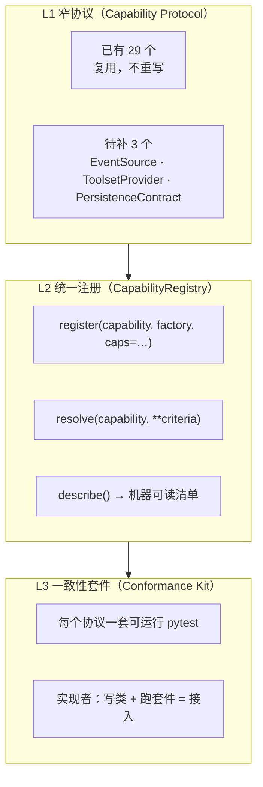

# 统一接缝规范（Plug-in Contract）— 2026-10

> 诉求：设计统一标准协议，让新部件「支持协议即可快速接入」。
> 前提约束：项目**已经很复杂** → 方案必须**减成本而非增抽象**。
> 结论先行：**不要做「一个大协议」**（本库已有 29 个 Protocol，再加一个统一大协议 = 第 30 个且制造新耦合）；要做的是**三层接缝规范**：窄协议 + 统一注册 + 一致性套件。

---

## 1. 先纠正前提：协议不缺，缺的是「合格标准」与「一致入口」

### 1.1 实测：协议已有 29 个

`AgentExecutor` `BacktestEngine` `Strategy` `DataLoader` `DataStore` `ExecutionSandbox` `MemoryManager` `PromptBuilder` `ContextInjector` `ToolGuard` `EventEmitter` `SwarmHook` `GroundingProvider` `CompletionStrategy` + 9 个 step 协议 + `WorkflowEventObserver` + `AgentValidatorLike` …

且已有**「加一个部件只改 1 处」的先例**：

| 部件 | 现状 | 接入成本 |
|---|---|---|
| LLM provider | 写 adapter 类 + 在 `llm/provider/__init__.py::_REGISTRY` 加一行 | ✅ 2 步，**不改任何核心文件**（其 docstring 自陈） |
| 数据源 | 实现 `DataLoader` 协议 + `data_source/registry.py::register` | ✅ 2 步，且有 `resolve_loader_with_fallback` 降级链 |
| 工具 | 写成 plugin（`AgentPlugin`）→ `AgentPluginRegistry` | ✅ 2 步 |
| **存储/账本** | **11 个具体 store 模块，无协议、无注册** | ❌ 靠读代码模仿约定 |
| **事件源** | `EventStore` 是 706 行**具体类**（`core/agent/event_store.py`） | ❌ 不可替换 |
| **工具集** | `TOOLSETS: dict[str, list[str]]`（不是协议） | ❌ 只能列名字，不能自定义筛选逻辑 |

### 1.2 真正的三个成本来源

| 成本 | 证据 | 后果 |
|---|---|---|
| **① 没有一致性套件** | 全库 0 个 conformance/contract 套件（`tests/` 检索） | 协议只是「建议」；实现者不知道做到什么程度算合格；接入后靠人肉 review |
| **② 注册方式 5 套并存** | `AgentPluginRegistry` / `TOOLSETS` dict / provider `_REGISTRY` / `data_store_registry` / MCP `register` | 新部件不知道该注册到哪；跨接缝复用无从下手 |
| **③ 能力不可发现** | 无跨接缝的「谁能做 X」查询 | 运行时只能硬编码；换实现要改调用方 |

**所以「快速接入」的杠杆不在「多写一个协议」，而在：把「合格」变成可运行的检查（套件），把「注册」收敛成一处，把「能力」变成可查询的元数据。**

---

## 2. 三层接缝规范



### L1 · 窄协议（复用为主，只补 3 个）

**协议规范（硬性约束）**：

| 规则 | 说明 |
|---|---|
| 窄 | **3–5 个方法**；超过 5 个说明职责该拆 |
| 结构化子类型 | 用 `Protocol`（鸭子类型），**不用 ABC 强制继承**；实现方无需 import 我们的基类 |
| 无状态优先 | 协议方法不持有生命周期（生命周期由注册/工厂管理） |
| 数据传入传出 | 用 dataclass 传结构化数据，不用「万能 kwargs 字典」 |
| 可组合 | 协议之间不互相依赖（A 协议不要求 B 协议） |
| 版本化 | 每个协议带 `PROTOCOL_VERSION`；破坏性变更 = 新协议名或 major bump |

**待补的 3 个**（其余一律复用现有）：

| 协议 | 现状 | 方法草案 | 为什么必要 |
|---|---|---|---|
| `EventSource` | `EventStore` 是具体类 | `emit(event) -> None` · `subscribe(session_id) -> AsyncIterator[Event]` · `replay(session_id, since) -> list[Event]` | 0.2 刀（SSE 双轨收敛）的**前置**：只有它是协议，才能让「旧 buffer / 原生 subscribe / 第三方源」可替换 |
| `ToolsetProvider` | `TOOLSETS` 是 dict | `resolve(role, task) -> list[str]` · `describe() -> dict[str, ToolsetInfo]` | 让 toolset 可按角色/阶段动态计算，而不只是列名字 |
| `PersistenceContract` | 11 个具体模块 | 每类存储的**真源 / 写入者 / 生命周期 / 幂等性**——**不是方法协议，是契约文档 + 一致性测试** | 0.4 刀的落点；**不写接口，只立契约** |

> 明确**不**补：Step / Hook / Injector / Tool / Provider / DataSource / DataStore 协议——**它们已经存在**。

### L2 · 统一注册（收敛 5 套为 1 套）

复用 `AgentPluginRegistry` 已验证的设计（id / category / `requires` 依赖闭包 / `optional` / `validate_selection`），上提为**跨接缝**的注册表：

```python
# core/capability/registry.py
@dataclass(frozen=True)
class CapabilitySpec:
    kind: str                      # "llm_provider" | "data_source" | "tool" | "store" | ...
    name: str                      # 稳定标识
    factory: Callable[..., Any]    # 构造工厂
    caps: frozenset[str]           # 能力标签：{"ohlcv", "intraday", "write"} ...
    requires: tuple[str, ...]      # 依赖（按 name）
    optional: bool = False
    version: str = "1"
    priority: int = 0              # 同能力多实现时的选择序

class CapabilityRegistry:
    def register(self, spec: CapabilitySpec) -> None: ...
    def resolve(self, kind: str, **criteria) -> Any: ...   # 按 caps/priority 选
    def resolve_all(self, kind: str, **criteria) -> list[Any]: ...
    def describe(self) -> dict: ...                        # 机器可读清单（供 CLI/文档/前端）
    def validate(self) -> list[str]: ...                   # 依赖闭包 + 冲突检测
```

**统一入口**（所有现有注册表最终指向这里，但**不强制立刻迁移**）：

```python
from strategy_research.core.capability import registry

@registry.provider("llm", caps={"chat", "tool_call"}, version="1")
class MyProvider:
    ...
```

**兼容策略**：现有 5 套注册表保留为**薄适配器**（内部调用 `CapabilityRegistry`），逐个迁移，不做大爆炸替换。

**能力清单产物**：`registry.describe()` → `docs/capability-manifest.json`（或 md），**一份机器可读的「系统能做什么」**，CI 校验它与代码一致（防止文档漂移——这正是过往踩过的坑：`openapi.json` / `types.gen.ts` 同步）。

### L3 · 一致性套件（**这是「即插即用」真正成立的地方**）

每个协议一个**可运行的 pytest 套件**，实现者只需「写类 + 跑套件」：

```
tests/conformance/
  test_provider_conformance.py      # 断言 name/base_url/model/thinking 抽取/错误映射
  test_data_loader_conformance.py   # 断言 load() 契约 + fallback 链
  test_event_source_conformance.py  # 断言 emit→subscribe 顺序/replay 语义/无丢失
  test_toolset_provider_conformance.py
  test_persistence_conformance.py   # 真源/幂等/生命周期断言
```

**套件写法范式**（关键设计）：

```python
# tests/conformance/base.py
def assert_provider(obj):          # 协议无关的最小断言集
    assert obj.name and isinstance(obj.name, str)
    assert obj.default_base_url.startswith("http")
    # ... 协议级最小行为断言

@pytest.fixture(params=ALL_PROVIDERS)   # 自动覆盖所有已注册实现
def provider(request): return request.param
```

**收益**：
- 实现方**不需要读我们的源码**——读套件即可
- 回归时所有实现一起被验证（新增实现 = 新增一个参数）
- CI 里 conformance 绿 = 「接缝没破」

---

## 3. 声明式接入范式（三个例子）

| 场景 | 接入动作 | 改动文件数 |
|---|---|---|
| 新增 LLM provider | 写 `class X(ProviderAdapter)` + 1 行 `@registry.provider(...)` | **1 新文件 + 1 行**（现状已接近，改造后有 conformance 背书） |
| 新增数据源 | 写 `class X` 实现 `DataLoader` + 1 行注册（含 `caps`） | **1 新文件 + 1 行** |
| 新增存储后端 | 实现 `PersistenceContract` 的 4 项元数据 + 1 行注册 | **1 新文件 + 1 行**（现状：读 11 个 store 源码模仿） |
| 新增工具集策略 | 实现 `ToolsetProvider.resolve()` | 1 新文件 + 1 行 |

**统一后的接入成本目标**：**新部件 = 1 个文件 + 1 行注册 + 跑一遍 conformance 套件**。

---

## 4. 协议演进规则（防止「统一协议」变成「统一负担」）

| 规则 | 说明 |
|---|---|
| 只加不改 | 协议方法只增；破坏性变更 = 新协议名（旧名标 `@deprecated`，保留 1 个版本周期） |
| 窄优先 | 新方法前先问：能否用现有方法组合出来？ |
| 不做万能协议 | 若某协议 > 5 个方法或含「可选的 8 个能力开关」，说明职责该拆（如 `cache_validation(metrics, ttl)` 那种**参数名都对不齐**的接口就是反例） |
| 默认实现可选 | 协议可提供 `default` 工厂，让 80% 场景零配置 |
| 协议不带业务 | 协议只说「怎么交互」，不写「默认做什么」——默认值在工厂里 |

---

## 5. 与主线的合并（不新开线）

| 波 | 新增刀 | 内容 | 估工 | 为什么放这 |
|---|---|---|---|---|
| **W0** | **0.6** | 建 `core/capability/`：`CapabilitySpec` + `CapabilityRegistry`；**先只包住 provider / data_source 两个已有注册表**（薄适配） | **1d** | 先证明「收敛注册」可行，再扩 |
| | **0.7** | 建 `tests/conformance/`：先 2 个套件（provider / data_loader） | **1d** | 一致性套件是接入提速的核心，且独立可交付 |
| **W1** | 1.6 | `EventSource` 协议落地（0.2 的前置）+ `event_store` 实现它 | 0.5d | 有了协议，事件源才可替换 |
| **W2** | 2.5 | `ToolsetProvider` 协议 + `PersistenceContract` 一致性测试 | 1d | 体量治理的配套 |

> **不动** `CapabilityRegistry` 与现有 5 套注册表的关系：0.6 只做「包住」，不做「替换」；替换留给「有人维护时顺手」。

---

## 6. 明确不做

| 不做 | 理由 |
|---|---|
| ❌ **不写「统一大协议」**（如 `UnifiedComponent` 覆盖所有部件） | 与 29 个现有协议冲突；部件职责本就不同（provider 与 tool 无共同语义） |
| ❌ 不用 ABC 强制继承 | 会让外部实现必须 import 我们的基类 → 违背「快速接入」 |
| ❌ 不做依赖注入框架 / 插件框架重写 | 现有 `AgentPluginRegistry` 已够用；重写是纯风险 |
| ❌ 不把 29 个协议合并成少数几个 | 合并=破坏；它们本就窄且正交 |
| ❌ 不为「统一」而统一 `TOOLSETS` 以外的东西 | 没有第二份清单可生成就没有价值 |

---

## 7. 度量

| 度量 | 现在 | 目标 |
|---|---|---|
| 新部件接入改动面 | 1 文件 + 1 行（provider/data_source）/ 靠读源码（store） | **统一：1 文件 + 1 行 + 1 套件** |
| 协议一致性自动校验 | 0 套件 | **每协议 ≥1 套件**，CI 绿 |
| 注册表数量 | 5 套 | 1 主 + N 薄适配（对外 API 不变） |
| 机器可读能力清单 | 无 | `capability-manifest.json`，CI 校验不漂移 |
| 接缝可替换性 | EventSource/Toolset/Store **不可替换** | 三者均可替换（协议化后） |

---

## 8. 一句话

> 「统一协议」的诉求是对的，但**统一的对象不是协议，是「合格标准 + 注册入口 + 能力清单」**。
> 本库已有 29 个窄协议，缺的是**可运行的一致性套件**与**单一注册入口**；
> 补这两样，新部件的接入成本才从「读源码模仿」降到「写类 + 一行 + 跑套件」——
> 这才叫「支持协议即可接入」。
