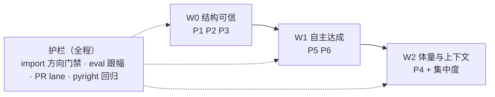

# 总改造计划 — 2026-10（收敛版 · 单主线）

> 输入：四遍评审的结论（`architecture-reeval` / `architecture-reeval2` / `agent-design-reeval` / `goal-alignment-review`）+ G1/G2 规格 + 本轮复杂度盘点。
> 约束（用户明确）：**当前已经很复杂 → 计划必须收敛，不能再开并行线。**
> 性质：唯一主线。每刀有目标/动作/验收/回滚/依赖。

## 0. 架构是否合理？——判定

**合理，但「能力面增长快于结构面收敛」。**

### 0.1 该保留的（不要动，它们是资产）

| 资产 | 证据 | 判断 |
|---|---|---|
| 六层分层与对称契约 | `BranchContext` 入 / `RoundOutcome` 出；查表分派 | ✅ 正确 |
| 扩展面分工与红线 | 9 step / hooks(只读) / injector(加数据) / toolset(能力) + `extension-points.md` 决策树 | ✅ **比多数 agent 框架成熟** |
| 研究方法论 | hypothesis / claims / AEGIS(新颖性·回归) / 两阶段 journal | ✅ 差异化护城河 |
| 质量资产 | 12k+ 测试 · 70 题 golden eval · nightly 门禁 · pyright 回归门禁 | ✅ 真实 |
| 类型债治理机制 | 958→225，regressions-gate 已接 | ✅ 方法论正确 |

### 0.2 复杂度到底来自哪里（盘点）

| 指标 | 数值 | 判读 |
|---|---|---|
| src | 927 文件 / 131k 行 | — |
| **>800 行文件** | **25 个 / 28k 行 = 21% src** | 改动成本集中在这 25 处 |
| 扩展面 | 9 step + 7 mixin + 39 hook 方法 + 5 injector + 16 toolset + 44 tool | **面宽 = 复杂度主因** |
| 持久化面 | **11 个 store/db/persistence 模块** | 无统一契约 |
| 编排面 | study / swarm / workflow / goal **4 套** | 边界靠口口相传 |
| alpha_zoo | 468 文件 / 25.7k 行（20%） | **是数据资产，不是复杂度源，别动** |

### 0.3 真正的问题只有 6 条（其余都是它们的症状）

| # | 问题 | 证据锚点 | 归属 |
|---|---|---|---|
| **P1** | 依赖方向倒置（core→api） | `event_store→projector`、`langgraph→bridge_v2`、`scheduler→web_session._get_db` | W0 |
| **P2** | SSE 双轨 | 旧 `SSEEventBuffer` + 原生 `subscribe()` 并存 | W0 |
| **P3** | 持久化无统一契约 | 11 个 store 模块 | W0（先立契约） |
| **P4** | 上下文无仲裁者 | 3 套估算 / `validate()` 死契约 | W2 |
| **P5** | 记忆断裂 | agent 不写 · 只 pre-run · 位置错 · 假设默认不取 | W1 |
| **P6** | **导演层缺失** | `HypothesisStore.derive/contradicts` 无工具出口；`propose` = 0 | W1 |

> **P1–P3 是「结构可信度」问题；P4–P6 是「自主性达成度」问题。** 先做前者——否则 W1 的新能力会继续加在歪的结构上。

## 1. 单主线：三波九刀

### W0 · 结构可信（让「分层」从文档变成事实）

| 刀 | 动作 | 验收 | 回滚 | 依赖 | 估工 |
|---|---|---|---|---|---|
| **0.1** | `scheduler._get_db` → `core/session/db.SessionDB` | 编排层不再 import 路由私有符号 | 单文件回退 | — | **0.5h** |
| **0.2** | **SSE 双轨收敛**：`/api/chat/events` 改读 `event_store.subscribe()`；删 `sse_buffer.py` / `bridge_v2.py` / `_sse_pusher` | 对外事件通道 = 1；`langgraph_engine` 反向 import 消失；SSE 测试绿 | 恢复旧端点读法（1 个 commit） | 0.1 | **1.5–2d** |
| **0.3** | `event_store` 去除对 `Projector` 的认识（改为订阅/回调） | `core→api` 反向 import = **0** | 恢复 lazy import | 0.2 | **0.5d** |
| **0.4** | **持久化契约成文 + 一致性测试**：明确 4 类（session 消息流 / study 账本 / goal 账本 / 研究资产+hypothesis / memory）—— 各自的真源、写入者、生命周期 | 一份契约文档 + 5 条一致性测试；**不改实现** | 纯文档 | — | **1d** |
| **0.5** | **CI 门禁**：① `core/**` 禁 import `api/**`/`cli/**` ② 单文件路由数 ≤ 12 ③ 新增文件 > 800 行告警 | 门禁在 CI 生效并拦下违规 PR | 移除门禁 | 0.1–0.3 | **0.5d** |
| **0.6** | **统一注册（薄包装）**：建 `core/capability/`（`CapabilitySpec` + `CapabilityRegistry`），先只包住 provider / data_source 两个已有注册表 | 新部件 1 行注册；对外 API 不变 | 移除包装层 | — | **1d** |
| **0.7** | **一致性套件起步**：`tests/conformance/` 先 2 个（provider / data_loader） | 新实现进 CI 自动被验 | 删套件 | — | **1d** |
| **0.8** | **上下文中枢试点**：`ContextItem` + `ContextProvider` 协议 + `ContextHub` 骨架（**只收 1 个 provider**：goal）；**G1 的 ContextPlan 作为其「仲裁阶段」内嵌，不写两遍** | 1 个 provider 走通 provider→bundle→render | 移除 provider | — | **1.5d** |

**W0 退出标准**：`core→api` 反向 = 0 · 对外事件通道 = 1 · 持久化契约文档 + 测试就位 · CI 门禁生效。

### W1 · 自主达成（对齐「自行处理各种问题」）

| 刀 | 动作 | 验收 | 回滚 | 依赖 | 估工 |
|---|---|---|---|---|---|
| **1.1** | **暴露假设原语为工具**：`create_hypothesis` / `derive_hypothesis` / `contradict_hypothesis` / `list_hypotheses`（映射 `HypothesisStore` 现成 API） | agent 可派生/标注矛盾；新增 6 个单测 | 摘掉工具注册 | — | **0.5–1d** |
| **1.2** | **记忆注入三改**（G2-a）：位置 task 串→messages · 每条带 `[来源·日期·类型]` · `include_hypotheses` 默认 True | 注入落在 messages；条目含出处；prompt 快照测试 | 回到旧注入路径 | 0.4 | **1d** |
| **1.3** | **agent 写回记忆**（G2-c）：finalization 提炼「结论 / 失败因子 / 假设修正」落 `PersistentMemory` | 跑一轮 → 记忆库新增 ≥1 条 → 下一轮检索命中 | 停写（保留读） | 1.2 | **2d** |
| **1.4** | **`propose_next` 决策面**（D2）：停因映射为动作；`STAGNATION/DISCARD_STREAK/novelty拒绝` → 派生新假设继续；`TARGETS_MET/BUDGET` → 收尾 | 自主研究中出现 ≥1 次 propose；假设树非空 | 关掉该分支 | 1.1 + 1.3 | **2–3d** |
| **1.5** | **失败降级阶梯**（D3）：数据不可用 → 换源/放宽/降频；因子失败 → 记失败因子→派生变体→跳过 | 失败场景下自动尝试次数 > 0；无人工介入完成降级 | 退回只提示 | 1.3 | **2–3d** |
| **1.6** | **`EventSource` 协议**（接缝规范）：`EventStore` 实现它，事件源从此可替换 | core/agent 侧不再依赖具体 EventStore 类 | 保留具体类实现 | 0.2 | **0.5d** |
| **1.7** | **injector → provider 适配**（goal/todo/memory 三类）+ **记忆注入三改**（位置 task串→messages · 每条带出处 · 假设默认纳入） | 注入落在 messages 且带 `[来源·日期·类型]` | 回旧注入路径 | 0.8 | **1.5d** |

**W1 退出标准**：`propose_next` 调用率 > 0 · 降级自动尝试 > 0 · 记忆新增/轮 > 0 且下轮命中 · 人仍持有 objective 与预算。

### W2 · 体量与上下文（让后续改动便宜）

| 刀 | 动作 | 验收 | 回滚 | 依赖 | 估工 |
|---|---|---|---|---|---|
| **2.1** | **统一 token 估算**（G1-1）：3 套 → 1 套（`utils/token_utils`） | 同一消息集三处值一致 | 单点回退 | — | **0.5d** |
| **2.2** | **ContextPlan 影子模式**（G1-2）：只算不裁，`explain()` 进 trace | 1 周数据：多少轮会超、超多少、谁被裁 | 关闭 | 2.1 | **1d + 观察** |
| **2.3** | **ContextPlan 开启裁剪**（G1-3）：裁剪顺序固定；压缩降级为兜底；**实现落在中枢的仲裁阶段，不另起模块** | eval 跟幅不降；PR lane 绿 | 一行开关 | 2.2 | **2d** |
| **2.4** | **巨文件按切口拆**（每项独立）：study 路由切面（33→≤12 路由/模块）· session service 拆 3 协作者 · goal/study store 读写分仓 · autoresearch 消包 | >800 行文件 25 → ≤ 10 | 单项回退 | W0 完成 | 每项 1–2d |
| **2.5** | **接缝规范续**：`ToolsetProvider` 协议 + `PersistenceContract` 一致性测试 | 存储/工具集可替换；契约有测试背书 | 单项回退 | 0.4 / 0.7 | **1d** |
| **2.6** | **`ContextSnapshot`**（可回放/可 diff）→ 服务「上下文变化 → 行为变化」归因 | 改 prompt/工具/记忆后能 diff 两次运行上下文 | 关闭 | 0.8 / 2.3 | **1.5d** |

**W2 退出标准**：单文件路由 ≤ 12 · 上帝服务方法 ≤ 12 · >800 行文件 ≤ 10 · 上下文装配恒不超预算且 `validate()` 必过。

## 2. 明确不做（防止复杂度继续长）

| 不做 | 理由 |
|---|---|
| 不加角色 preset / 不加工具 / 不加第 5 种编排机制 | 扩展面已 16 toolset + 4 编排，**面宽就是复杂度源** |
| 不引入 `EngineProtocol`、不合并 phases 与 langgraph | 已有勘误文档判定为作废；查表分派 + 双契约已够 |
| 不把 store 迁 ORM / 不换数据库 | 查询面测试厚，**拆文件**即可 |
| 不为 pyright 清零重写 mixin | 收益是数字不是运行时；已注解止血 |
| **不拆 `alpha_zoo`（468 文件 / 20% 代码）** | 它是数据资产，不是复杂度源；拆了反而增加耦合面 |
| 不做「一次到位」的大重构 | 违反本计划的可回滚分刀原则 |
| **不写「统一大协议」**；不合并现有 29 个协议；不重写插件框架 | 见 `plug-in-contract-design.md` §6——统一的是「合格标准 + 注册入口 + 能力清单」，不是协议数量 |

## 3. 护栏（每刀都适用）

| 护栏 | 说明 |
|---|---|
| **契约测试先行** | 每刀先写/补契约测试，再改实现 |
| **eval 跟幅** | 70 题 golden：mean / pass@0.7 不下降；下降即停（`scripts/check_eval_regression.py`） |
| **PR lane 绿** | `not llm and not e2e and not slow` 0 failed |
| **pyright 回归门禁** | 已接；只许降不许升 |
| **A/B 归因** | 可疑失败先 stash 对照 |
| **一行开关** | W1/W2 的行为性改动均带 feature flag，可即时回退 |
| **每刀一 commit** | 便于二分定位与回退 |

## 4. 时间盒与依赖图

```mermaid
gantt
  dateFormat X
  axisFormat %s
  section W0 结构可信
  0.1 私有符号泄漏      :0, 1
  0.2 SSE 双轨收敛      :1, 4
  0.3 event_store 去反向 :4, 5
  0.4 持久化契约        :1, 2
  0.5 CI 门禁           :5, 6
  section W1 自主达成
  1.1 假设工具          :6, 7
  1.2 记忆注入三改      :7, 9
  1.3 agent 写回        :9, 12
  1.4 propose_next      :12, 16
  1.5 降级阶梯          :16, 20
  section W2 体量上下文
  2.1 统一估算          :6, 7
  2.2 影子模式          :7, 8
  2.3 开启裁剪          :20, 23
  2.4 巨文件拆分        :16, 30
```

（单位：工作日；W2.1/2.2 可与 W1 并行，因为不碰运行时行为）

**总估工**：W0 ≈ 4.5d · W1 ≈ 9d · W2 ≈ 4d + 拆分按项计（4–8d）

## 5. 成功度量（前后可测）

| 度量 | 现在 | 目标 | 归属 |
|---|---|---|---|
| `core→api` 反向 import | 3 | **0** | W0 |
| 对外事件通道 | 2 | **1** | W0 |
| 持久化契约 | 无 | 4 类 + 一致性测试 | W0 |
| `propose_next` 调用率 | 0（能力不存在） | **> 0** | W1 |
| 失败自动降级尝试 | 0 | **> 0** | W1 |
| 记忆新增/轮 & 下轮命中 | 0 | **> 0** | W1 |
| 上下文超预算轮次 | 未知 | **0**（`validate()` 恒过） | W2 |
| 单文件路由数 | 33 | **≤ 12** | W2 |
| 上帝服务方法数 | 24 | **≤ 12** | W2 |
| >800 行文件 | 25 | **≤ 10** | W2 |
| pyright errors | 225 | ≤ 225（不增） | 全程 |
| 协议一致性套件数 | 0 | ≥ 1 套/协议（先 provider + data_loader） | W0 |
| 机器可读能力清单 | 无 | `capability-manifest.json`（CI 校验不漂移） | W0 |

## 6. 每波的「继续/停止」判据

| 波 | 继续条件 | 停止条件（回退） |
|---|---|---|
| W0 | 0.2 完成后 SSE 与 session 测试连续 3 次全绿 | SSE 稳定性回退 > 1 次，或 eval 跟幅下降 > 1% |
| W1 | 1.2 后 eval 跟幅不降；1.3 后记忆有可测增长 | 连续两波 eval 下降 → 停 W1，先做 W2 的上下文治理 |
| W2 | 影子模式数据说明裁剪影响可控 | 裁剪后 eval 下降 → 保留影子模式，回退裁剪，只做 2.4 拆分 |

## 7. 决策请求（开会需拍板 4 条）

1. **W0 是否先于 W1？**（我的建议：是——否则新能力继续加在歪的结构上）
2. **1.4 `propose_next` 的权限边界**：agent 提案直接执行，还是需人确认？（建议：默认直接执行 + 人可 veto，预算类不动）
3. **2.4 拆分优先级**：先 study 路由（扇入 29）还是先 session service（自主性相关）？（建议：先 session service）
4. **alpha_zoo 明确不拆**，是否同意？

---

**附：本文档取代**此前分散在四份评审中的行动项（`architecture-reeval` §4 / `architecture-reeval2` §3 / `agent-design-reeval` §5 / `goal-alignment-review` §5）——四份保留作**论证依据**，行动项以本文为准。
