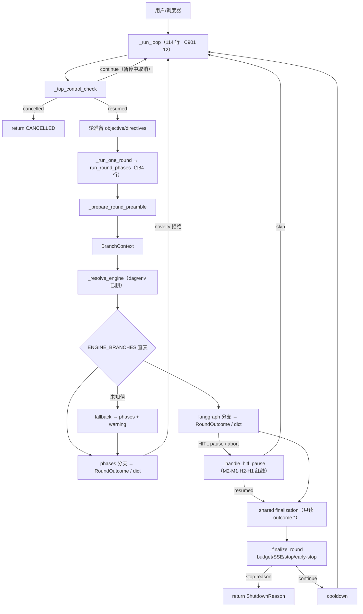
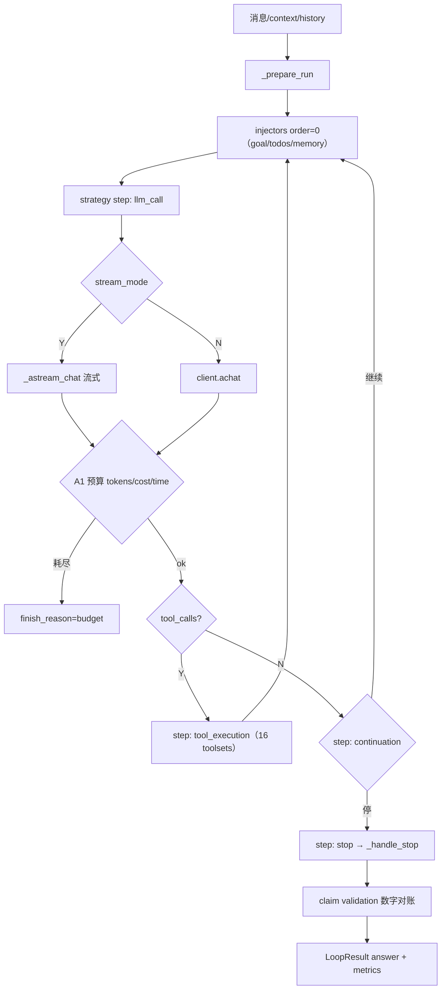

# 重构就绪包 — 架构图 · 流程图 · 数据流 · 切入点

> 服务「重构这个项目」的决策输入。图源：`architecture-refactor-input.svg`（架构）+ 本文档 §2-4（流程/数据流 mermaid）。
> 前置阅读：`architecture-current-20261008.md`（契约细节）· `extension-points.md`（扩展点红线）。

## 1. 架构图

`architecture-refactor-input.svg`——六层 + **契约面标注**（BranchContext 入 / RoundOutcome 出、查表分派、已删模块）。分层与连接的细节同 `architecture-current-20261008.md`。

## 2. Study 执行流程（重构后 helper 形态）



## 3. Agent ReAct 流程



## 4. 数据流

```mermaid
flowchart LR
    UI["UI/CLI"] --> API["FastAPI / CLI"]
    API --> SS["SessionService"]
    API --> SR["StudyRunner"]
    SS --> SDB[("session sqlite\nmessages · attempts")]
    SR --> STB[("study sqlite\nstudies · state")]
    SR --> AL["AgentLoop"]
    AL --> LLM["LLM（httpx）"]
    AL --> TL["toolsets"]
    TL --> WS[("workspace FS\nstrategy.py · results.tsv · rounds")]
    TL --> DK[("DuckDB\n回测 metrics")]
    AL --> ES[("event_store\nemit 三助手）"]
    ES --> SSE["SSE 推送"] --> UI
    ES --> PJ["Projector.flush"] --> SDB
    AL --> GS[("goal store\njournal A→B 两阶段）"]
    LG["langgraph 引擎"] --> CP[("checkpoint sqlite\nHITL resume）"]
    SR --> GS
```

**数据流红线**（重构时不要破坏）：
1. event_store 是 session 消息的**真源**（projector 只是物化视图，flush best-effort）
2. goal journal 两阶段：capture（backtest 前）→ backfill（finalization）——claims 可证伪性依赖此顺序
3. workspace FS 是 study 状态的可 git 面（round 目录/strategy 继承链）
4. checkpoint 只属于 langgraph 路径（phases 无 resume）

## 5. 重构切入点（按图索骥）

| 切入点 | 架构图位置 | 为什么是它 | 风险/护栏 |
|---|---|---|---|
| **A. web_session ↔ projector 对**（1503+1493 行） | 编排↔数据：SSE/Projector 三角 | 唯一同主题巨文件对；event_store 三助手刚拆完（emit 已 ≤10 分支）是顺势 | 中；session SSE 测试 + 69 回归 |
| **B. mixin → composition**（AgentLoop 6 mixin） | 编排层 AgentLoop | 12 个 F821 的结构性根源（隐式 self.*）；契约思想（ctx/outcome）已就位可移植 | 中高；逐步替换，新代码规则先行 |
| **C. chat_loop / role_factory 双入口收口** | AgentLoop 构造 | 两套构造 = 两处配置漂移源 | 低；config preset 合一 |
| **D. 扩展机制收敛**（7 → 分工合并） | 能力层 hooks/injectors/steps | extension-points 红线已立，机制合一是执行 | 中；需逐机制迁移调用方 |
| **E. store 层分仓**（study 1618 + goal 1772） | 数据层 | 两个大 store 同为「单文件仓储」，SQL 面可分离 | 中低；查询面测试多 |

**推荐起手**：A（顺势、护栏足、架构图上是清晰的边界）；B 是长期主线（每触一个 mixin 顺手改）；C 小时可完；D/E 有需求再动。

## 6. 重构护栏（每次动刀前的清单）

1. 69 文件回归 PR-lane（1162 基线，0 flaky）
2. 相关契约测试（RoundOutcome/BranchContext/dispatch/claims）
3. A/B 归因法（可疑失败先 stash 对照）
4. API 面改动 → 同步 `openapi.json` + `types.gen.ts`（第四轮教训）
5. 语义红线逐条对照（`architecture-current` §3：ARCHIVED 保留/M2 bank/M1 expire/H2/H1）
